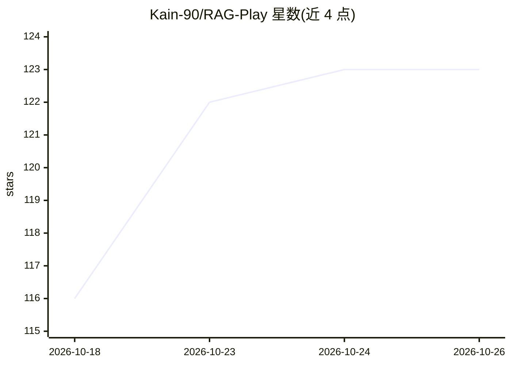

# Kain-90/RAG-Play

⭐ 123 · TypeScript · MIT · 推送 2026-10-11 · [GitHub](https://github.com/Kain-90/RAG-Play) · [官网](https://rag-play.vercel.app) · 个人维护

**交互式 RAG 流程可视化工具：分步演示与调试检索增强生成**

基于 Next.js 14 + TypeScript 构建的网页应用，面向开发者和研究人员，用于理解与调试 RAG 流水线。分标签页演示文本切分策略、向量嵌入生成与相似度计算、语义检索以及上下文与查询结合生成回答的过程；向量运算使用 Transformers.js，文本处理使用 LangChain，可在浏览器中实时操作。通过 git clone 源码、npm/yarn/pnpm 安装依赖并复制 .env 配置后本地运行开发服务器。

## 筛选速览

| 维度 | 判定 | 备注 |
|---|---|---|
| AI 角色 | `ai-native` | 本体是模型或模型工具 |
| 许可风险 | `permissive` | MIT |
| 部署形态 | `library` | 以包/库形式分发 |
| 模型依赖 | — | README 未给出锁定关系 |
| 硬件要求 | — | 无带数字的原话,不猜 |
| 安装摩擦 | `low` | 无编译、无系统依赖或容器化 |
| 成熟度 | — | 结构信号不足 |

## 能力要点

- 文本切分可视化：展示不同切分策略下的文档分块
- 向量嵌入分析与高维空间中的相似度演示
- 实时向量相似度检索演示
- 生成环节演示检索上下文与用户查询的结合

## 适用场景

- 学习和理解 RAG 各步骤的原理
- 调试并对比不同文本切分与检索策略
- 向他人演示检索增强生成流程

## 场景标签

`RAG` · 领域:知识与检索

## 证据(README 行号)

> L3: An interactive visualization tool for understanding Retrieval-Augmented Generation (RAG) pipelines. This project hel
> L10: - **Vector Embedding Analysis**: See how text is transformed into numerical vectors and visualize their relationshi
> L12: - **Context Generation**: Observe how LLMs combine retrieved context with user queries to generate accurate, contex

## 星数曲线

2026-10-18 116 → 2026-10-26 123（+7）

---
*卡片 v1 · prompt 1.4 · 生成 2026-10-23 · 置信度 mid · 依据 README sha `8ec39c29d8fd` · [字段定义](../../DATASET.md)*
