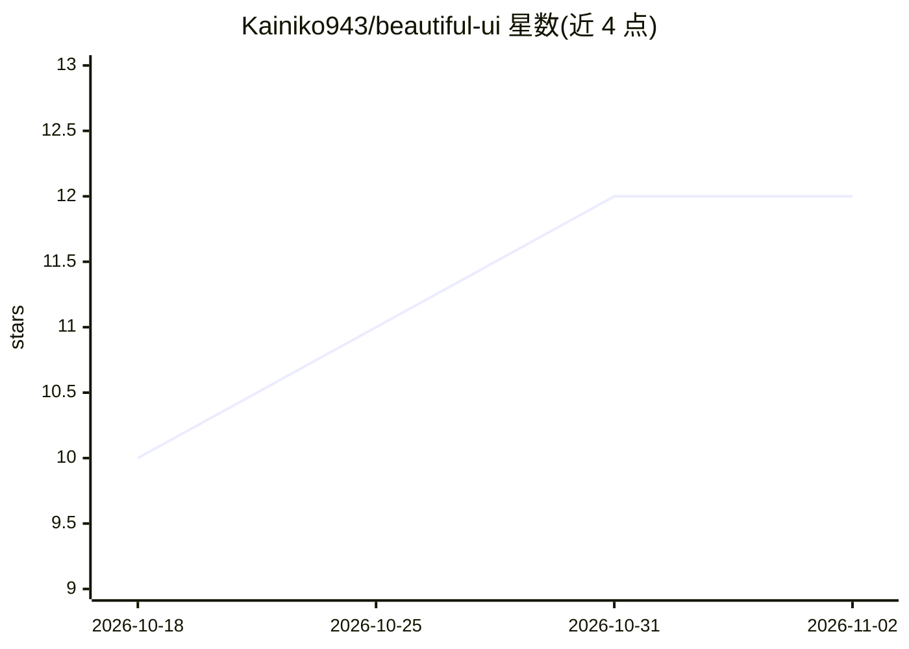

# Kainiko943/beautiful-ui

⭐ 12 · PowerShell · MIT · 推送 2026-04-26 · [GitHub](https://github.com/Kainiko943/beautiful-ui) · 个人维护

**教 AI 编程代理设计高质量 UI 的技能包**

面向 Codex、Claude Code、Cursor 等编程代理的 Markdown 技能包与平台适配器：在写 UI 代码前引导代理选定视觉方向、复用设计系统 token、覆盖空/加载/错误状态、适配目标平台并执行 ui-verification 校验。含 cinematic web 路径（视频、Lottie、Rive、Three.js 等技术阶梯）与 Playwright 截图验证、渲染画廊校验脚本。通过 git clone 加 PowerShell 脚本安装到代理技能目录；自述为 v0.1 发布包，示例与平台适配器待社区扩充；非完整 UI 代码生成器。

## 筛选速览

| 维度 | 判定 | 备注 |
|---|---|---|
| AI 角色 | `ai-knowledge` | 知识聚合/清单类 |
| 许可风险 | `permissive` | MIT |
| 部署形态 | `None` |  |
| 模型依赖 | — | README 未给出锁定关系 |
| 硬件要求 | — | 无带数字的原话,不猜 |
| 安装摩擦 | `low` | 无编译、无系统依赖或容器化 |
| 成熟度 | `idea` | |

## 能力要点

- 在实现前约束代理产出视觉方向、设计系统核心与状态覆盖清单
- cinematic web 路径含视频/Lottie/Rive/Three.js 技术阶梯与 Playwright 截图验证
- 兼容矩阵覆盖 Codex CLI、Claude Code、Cursor、Cline 等代理安装方式
- 提供渲染画廊校验脚本（尺寸、非空像素、溢出检查）

## 适用场景

- 让 Claude Code 或 Codex 在生成 UI 前遵循结构化设计工作流
- 为 cinematic 风格落地页项目约束技术选型与验证流程
- 提升代理生成界面的状态覆盖与可访问性说明

## 场景标签

`提示工程` · 领域:Agent 开发

## 证据(README 行号)

> L5: Beautiful UI is the taste layer Claude users install when they want S-tier UI instead of generic AI screens. It teac
> L83: This package is not a dependency on `Material`, not a fork or release of that Swift framework, and not a requiremen

## 星数曲线

2026-10-18 10 → 2026-11-02 12（+2）

---
*卡片 v1 · prompt 1.4 · 生成 2026-11-01 · 置信度 mid · 依据 README sha `0c8d54ec7642` · [字段定义](../../DATASET.md)*
