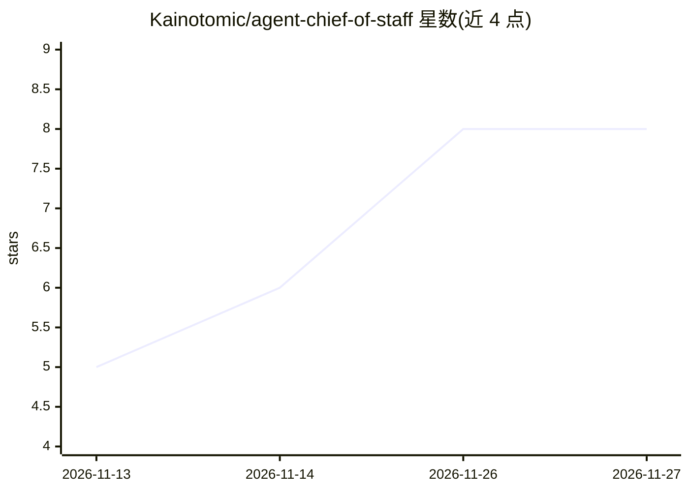

# Kainotomic/agent-chief-of-staff

⭐ 8 · MIT · 推送 2026-11-25 · [GitHub](https://github.com/Kainotomic/agent-chief-of-staff) · 个人维护

**协调多 AI agent 舰队的架构设计与参考脚本**

一份描述如何同时运行多个 AI 编码与运维 agent 的设计文档，附带仅用标准库的 Python 参考脚本。核心机制：一个常驻协调者 agent 维护持久化台账（ledger），向短生命周期 worker agent 下发精确简报，去重派发，合并/部署前设门禁，并要求可核验的完成证明；轮询由确定性脚本执行，仅在状态变化时唤醒模型。文档按契约描述各组件，不绑定特定 runner、模型厂商或代码托管平台。

## 筛选速览

| 维度 | 判定 | 备注 |
|---|---|---|
| AI 角色 | `ai-ecosystem` | LLM/agent 周边工具 |
| 许可风险 | `permissive` | MIT |
| 部署形态 | `None` |  |
| 模型依赖 | — | README 未给出锁定关系 |
| 硬件要求 | — | 无带数字的原话,不猜 |
| 安装摩擦 | `low` | 无编译、无系统依赖或容器化 |
| 成熟度 | — | 结构信号不足 |

## 能力要点

- 持久化台账记录任务状态，上下文压缩后可从磁盘重建
- 脚本轮询+哈希唤醒门，仅在状态变化时调用模型
- 合并/部署门禁与证明式关闭（close_row 要求可核验证据）
- 租约机制实现单写者多读者，含 epoch 防 fence

## 适用场景

- 同时运行多个编码/运维 agent 时避免重复开 PR 与漏检
- 需要 agent 任务状态跨会话持久化的团队
- 为 agent 舰队设计合并与部署的人工审批门禁

## 场景标签

`多智能体` `Agent 框架` · 领域:Agent 开发

## 证据(README 行号)

> L5: One long-running **coordinator** agent sits between a human owner and a fleet of short-lived **worker** agents. It k
> L7: This repository is a design document plus small reference sketches. It does not depend on any particular agent runne
> L43: 2. **Scripts poll, the model decides.** Polling with an LLM is slow, expensive and forgetful. A deterministic scrip

## 星数曲线

2026-11-13 5 → 2026-11-27 8（+3）

---
*卡片 v1 · prompt 1.4 · 生成 2026-11-20 · 置信度 high · 依据 README sha `78f6f706e111` · [字段定义](../../DATASET.md)*
