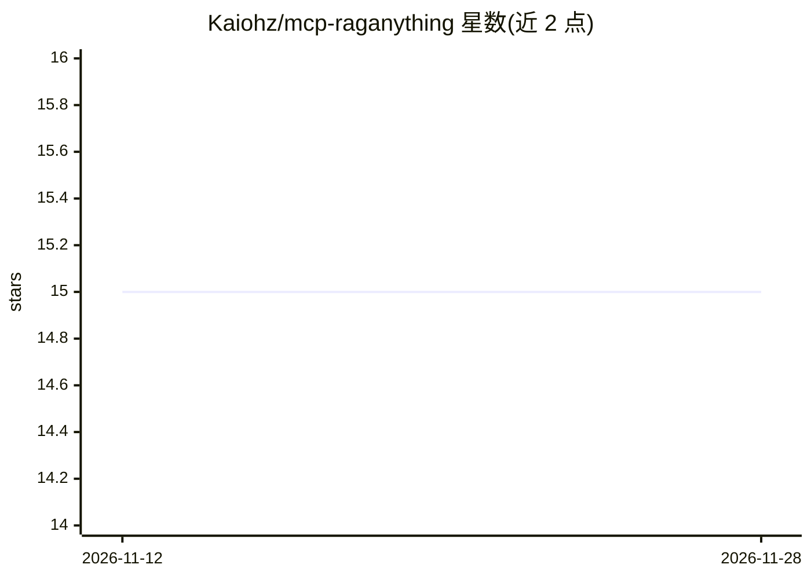

# Kaiohz/mcp-raganything

⭐ 15 · Python · 推送 2026-11-27 · [GitHub](https://github.com/Kaiohz/mcp-raganything) · 个人维护

**为 RAGAnything/LightRAG 提供 REST API 与 MCP 服务的多模态 RAG 服务**

基于 RAGAnything 与 LightRAG 的多模态 RAG 服务，暴露 REST API 与 MCP server：从 MinIO 拉取文档（PDF/Office/HTML/Markdown/图片等）索引到 PostgreSQL 知识图谱，支持 LightRAG 图管道与经典 RAG（多查询生成 + LLM-as-judge）两条检索路径，按 working_dir 隔离项目。另含 MCP server 注册表，可从 OpenAPI 文档即时生成新 MCP server。支持 JWT(Logto) 与每用户 API key 双重认证、每用户 LLM 凭据与 RAG 数据隔离；旧版 master API_KEY 与 OPEN_ROUTER_API_KEY 已标记废弃。生产经 Docker Compose 部署，本地开发需 Python 3.13+ 与 uv。

## 筛选速览

| 维度 | 判定 | 备注 |
|---|---|---|
| AI 角色 | `ai-ecosystem` | LLM/agent 周边工具 |
| 许可风险 | `none` | — |
| 部署形态 | `self-host` | docker 或自建部署 |
| 模型依赖 | — | README 未给出锁定关系 |
| 硬件要求 | — | 无带数字的原话,不猜 |
| 安装摩擦 | `low` | 无编译、无系统依赖或容器化 |
| 成熟度 | — | 结构信号不足 |

## 能力要点

- 双检索路径：LightRAG 图管道 + 经典 RAG（多查询生成/LLM-as-judge）
- MCP server 注册表：CRUD 注册外部 server 并可从 OpenAPI 文档生成新 server
- 双重认证（JWT/OIDC + 每用户 API key）与每用户 LLM 凭据、RAG 数据隔离
- 自动检测并索引 PDF/Office/HTML/Markdown/图片等多模态格式

## 适用场景

- 把文档库（MinIO 中的 PDF/Office/图片）变成可查询的知识库服务
- 让 MCP 客户端（如 Claude）通过统一端点发现和使用 RAG 与外部 MCP server
- 多用户场景下按用户隔离 LLM 凭据与检索数据

## 场景标签

`RAG` `多模态` · 领域:知识与检索

## 证据(README 行号)

> L3: Multi-modal RAG service exposing a REST API and MCP server for document indexing and knowledge-base querying, powere
> L5: The service also hosts the **MCP server registry** — a CRUD API for registering external MCP servers and generating 

## 星数曲线

2026-11-12 15 → 2026-11-28 15（+0）

---
*卡片 v1 · prompt 1.4 · 生成 2026-11-18 · 置信度 high · 依据 README sha `e52dc66a0fce` · [字段定义](../../DATASET.md)*
