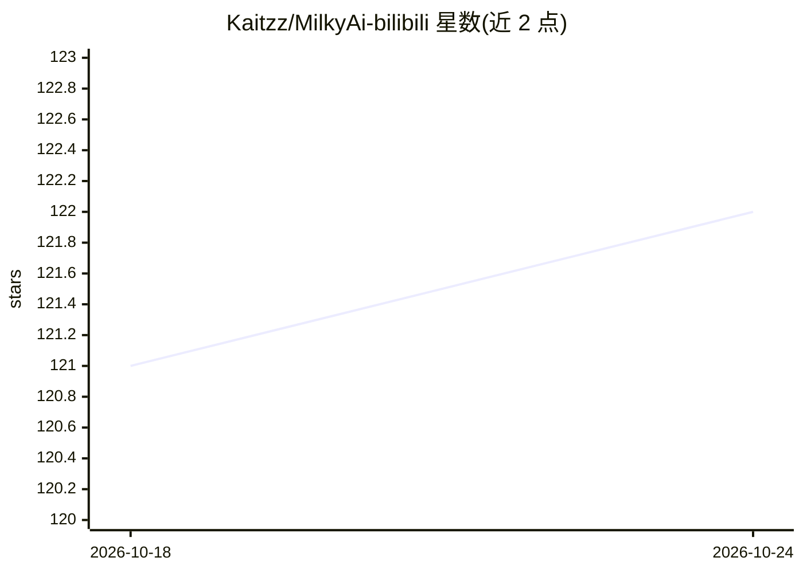

# Kaitzz/MilkyAi-bilibili

⭐ 122 · Python · 推送 2026-10-04 · [GitHub](https://github.com/Kaitzz/MilkyAi-bilibili) · [官网](http://corneliazhang.me/milky/) · 个人维护 · 中文 README

**Bilibili 视频转笔记邮件服务的工程展示仓库（架构骨架）**

面向 Bilibili 用户的视频转笔记服务：用户在评论区 @MilkyAi，系统分类请求、获取视频材料、生成摘要/字幕/中文翻译/Markdown 笔记，经评论、私信或 AWS SES 邮件交付；附带基于 RAG 与工具调用的私信客服。本仓库是公开展示用的架构骨架，非生产源码发布：不含生产提示词、平台适配与配置，明确声明不可部署克隆，无运行时依赖，仅可运行单元测试浏览代码结构。

## 筛选速览

| 维度 | 判定 | 备注 |
|---|---|---|
| AI 角色 | `ai-native` | 本体是模型或模型工具 |
| 许可风险 | `none` | — |
| 部署形态 | `None` |  |
| 模型依赖 | — | README 未给出锁定关系 |
| 硬件要求 | — | 无带数字的原话,不猜 |
| 安装摩擦 | `low` | 无编译、无系统依赖或容器化 |
| 成熟度 | — | 结构信号不足 |

## 能力要点

- 以 (bvid, page) 为标识的 DB-first 可复用视频工件（PostgreSQL）
- 受控 RAG 客服：产品知识库 + 类型化用户范围工具 + 确定性上下文规划器，含 41 场景回归评测
- asyncio 工作池（并发 3）与结构化交付结果（DM 分段、评论回退、SES 附件）
- 持久化请求诊断记录，区分未送达与生成/排队/配额/投递失败

## 适用场景

- 在 Bilibili 视频评论区请求摘要、问答或邮件笔记
- 获取带中文翻译的视频字幕与 Markdown 笔记
- 参考其异步编排、RAG 客服与工件复用的工程设计模式

## 场景标签

`RAG` `语音识别` `AI 写作` · 领域:内容生成

## 证据(README 行号)

> L5: Turn public videos into concise summaries, searchable transcripts, Chinese translations, and structured Markdown not
> L28: MilkyAi is invoked where the video already lives. A user mentions `@MilkyAi` in a Bilibili video comment and choose

## 星数曲线

2026-10-18 121 → 2026-10-24 122（+1）

---
*卡片 v1 · prompt 1.4 · 生成 2026-10-23 · 置信度 high · 依据 README sha `64709333e8cd` · [字段定义](../../DATASET.md)*
