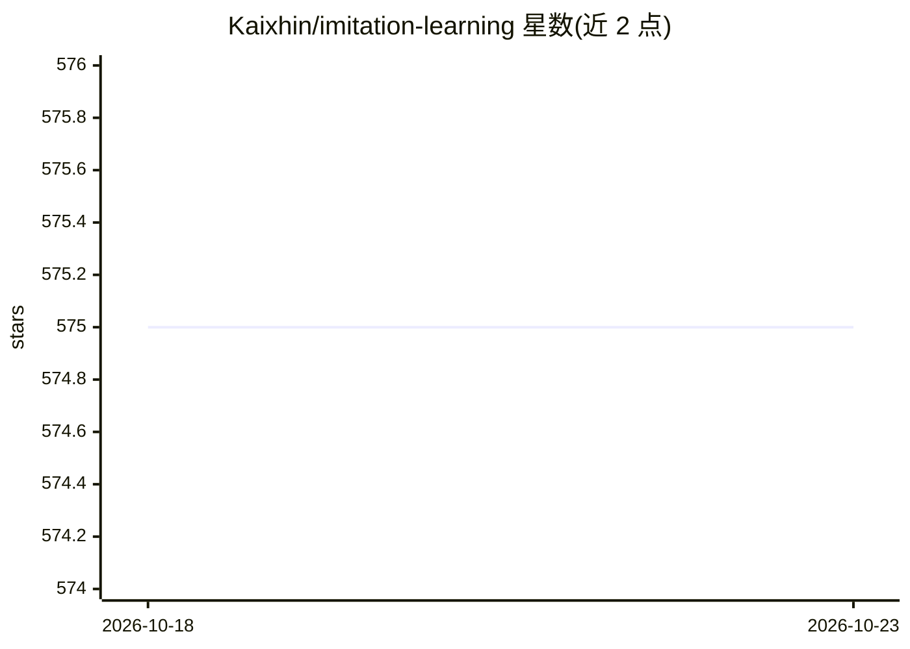

# Kaixhin/imitation-learning

⭐ 575 · Python · MIT · 推送 2026-10-16 · [GitHub](https://github.com/Kaixhin/imitation-learning) · 个人维护

**深度模仿学习算法集合：在 MuJoCo 上实现 6 种 IL 算法**

基于 PyTorch 与 SAC 的模仿学习算法库，实现 AdRIL、DRIL、GAIL、GMMIL、PWIL、RED 六种算法，各算法提供判别器、奖励塑形、损失函数等超参数选项；支持 BC 预训练、仅状态输入、混合专家数据等通用选项。以 Gym MuJoCo 环境与 D4RL expert-v2 数据为基准，通过 Hydra 配置运行训练脚本，支持超参数扫描与基于 Ax 的贝叶斯优化。面向从事模仿学习研究的开发者与科研人员。

## 筛选速览

| 维度 | 判定 | 备注 |
|---|---|---|
| AI 角色 | `ai-native` | 本体是模型或模型工具 |
| 许可风险 | `permissive` | MIT |
| 部署形态 | `library` | 以包/库形式分发 |
| 模型依赖 | — | README 未给出锁定关系 |
| 硬件要求 | — | 无带数字的原话,不猜 |
| 安装摩擦 | `low` | 无编译、无系统依赖或容器化 |
| 成熟度 | — | 结构信号不足 |

## 能力要点

- 实现 AdRIL/DRIL/GAIL/GMMIL/PWIL/RED 六种模仿学习算法
- 支持 BC 预训练、仅状态模仿、混合专家数据等通用选项
- 基于 Hydra 的超参数扫描与 Ax 贝叶斯超参数优化
- 附带按算法与轨迹数调优的超参数配置

## 适用场景

- 在 Gym MuJoCo 环境上训练并对比模仿学习算法
- 复现或扩展 ACML 2023 论文《A Pragmatic Look at Deep Imitation Learning》
- 对模仿学习算法做超参数扫描与调优实验

## 场景标签

`强化学习` `模型训练` · 领域:训练与推理

## 证据(README 行号)

> L5: Imitation learning algorithms (using SAC [[HZA18, HZH18]](#references) as the base RL algorithm):
> L65: The training of each imitation learning algorithm (or SAC with the real environment reward) can be started with:

## 星数曲线

2026-10-18 575 → 2026-10-23 575（+0）

---
*卡片 v1 · prompt 1.4 · 生成 2026-10-21 · 置信度 mid · 依据 README sha `3b46779a6e2b` · [字段定义](../../DATASET.md)*
