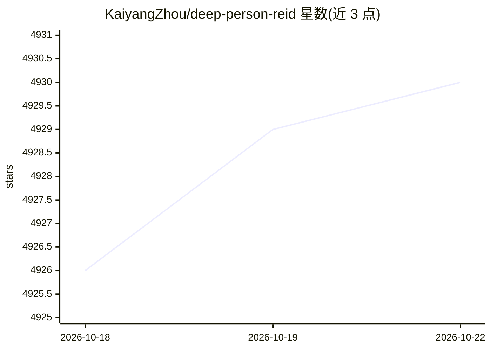

# KaiyangZhou/deep-person-reid

⭐ 4,930 · Python · MIT · 推送 2026-01-09 · [GitHub](https://github.com/KaiyangZhou/deep-person-reid) · [官网](https://kaiyangzhou.github.io/deep-person-reid/) · 个人维护

**PyTorch 行人重识别（re-ID）深度学习库**

Torchreid 是用 PyTorch 编写的行人重识别库，配套作者 ICCV'19 OSNet 项目。支持图像与视频 reid、多 GPU 训练、多数据集训练与跨数据集评估、端到端训练评测，并提供模型库与 ImageNet 预训练权重（Huggingface 上有 OSNet 权重），可将模型导出为 ONNX/OpenVINO/TFLite。安装方式为 git clone 源码加 conda 环境（python setup.py develop），或用 Docker 构建；还提供统一命令行接口与 configs 预设配置。

## 筛选速览

| 维度 | 判定 | 备注 |
|---|---|---|
| AI 角色 | `ai-native` | 本体是模型或模型工具 |
| 许可风险 | `permissive` | MIT |
| 部署形态 | `library` | 以包/库形式分发 |
| 模型依赖 | — | README 未给出锁定关系 |
| 硬件要求 | — | 无带数字的原话,不猜 |
| 安装摩擦 | `medium` | 含编译或系统依赖之一 |
| 成熟度 | — | 结构信号不足 |

## 能力要点

- 图像与视频 reid、多 GPU 训练与端到端训练评测
- 多数据集训练与跨数据集评估
- 模型可导出 ONNX/OpenVINO/TFLite
- 提供模型库、预训练权重与特征提取 API

## 适用场景

- 在 Market1501/DukeMTMC-reID 等数据集上训练和评测 reid 模型
- 做跨数据集/跨域行人重识别研究
- 加载预训练 OSNet 提取行人特征或部署导出

## 场景标签

`图像视频处理` · 领域:感知与多模态

## 证据(README 行号)

> L2: Torchreid is a library for deep-learning person re-identification, written in `PyTorch <https://pytorch.org/>`_ and 
> L6: - multi-GPU training

## 星数曲线

2026-10-18 4,926 → 2026-10-22 4,930（+4）

---
*卡片 v1 · prompt 1.4 · 生成 2026-10-20 · 置信度 mid · 依据 README sha `7b42b2103e78` · [字段定义](../../DATASET.md)*
