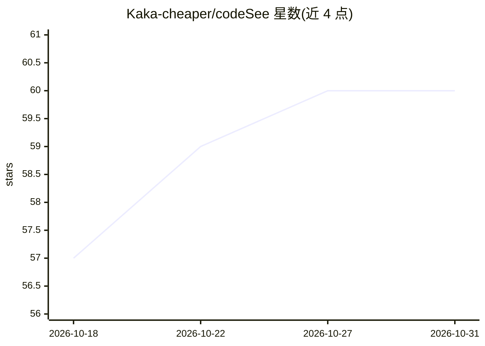

# Kaka-cheaper/codeSee

⭐ 60 · TypeScript · MIT · 推送 2026-07-17 · [GitHub](https://github.com/Kaka-cheaper/codeSee) · 个人维护 · 中文 README

**AI 维护的项目功能语义流程图查看器：让 AI 写图，人看故事**

面向使用 Cursor / Claude Code / Kiro 等 AI IDE 的开发者与小团队：安装脚本向项目写入 AGENTS.md、SKILL.md 技能与提示词，AI 在每次代码变更后生成/增量更新 .codesee/features.json，浏览器端查看器（GitHub Pages 托管，基于 File System Access API 读取本地文件）以 Epics→Features→Steps 三级视图渲染语义流程图，支持拖拽布局、3 秒轮询热更新、内置校验器与引导式漫游（Guided Tour）。数据为纯 JSON、git 可 diff；可自动检测 Spec Kit/Trellis/BMAD 等 SDD 框架直接消费规格文档。README 自述处于活跃开发期，schema 可能在小版本间变化。

## 筛选速览

| 维度 | 判定 | 备注 |
|---|---|---|
| AI 角色 | `ai-ecosystem` | LLM/agent 周边工具 |
| 许可风险 | `permissive` | MIT |
| 部署形态 | `None` |  |
| 模型依赖 | — | README 未给出锁定关系 |
| 硬件要求 | — | 无带数字的原话,不猜 |
| 安装摩擦 | `low` | 无编译、无系统依赖或容器化 |
| 成熟度 | `idea` | |

## 能力要点

- AI 在每次代码变更后增量更新 features.json，无需手工绘图
- Epics→Features→Steps 三级下钻的语义流程图（含异步/条件/错误分支）
- 跨平台 SKILL.md 标准，兼容 Claude Code / Cursor / Codex 等 20+ 平台
- 查看器经 File System Access API 直读本地文件，不上传任何内容

## 适用场景

- AI 大量产出代码后，在画布上追踪项目功能与变更
- 为使用 Cursor / Claude Code / Kiro 的独立开发者维护活的功能架构图
- Spec-Driven Development 项目直接从 spec/PRD 生成功能图

## 场景标签

`知识图谱` · 领域:知识与检索

## 证据(README 行号)

> L72: |**AI-maintained**|AI writes `features.json` after every code change. No manual diagramming. Works with any AI IDE.
> L82: |**Auto hook wiring**|One-shot `install --auto-detect` writes a Stop hook into Claude Code / Kiro that reminds AI t

## 星数曲线

2026-10-18 57 → 2026-10-31 60（+3）

---
*卡片 v1 · prompt 1.4 · 生成 2026-10-24 · 置信度 high · 依据 README sha `f3b55f47551d` · [字段定义](../../DATASET.md)*
