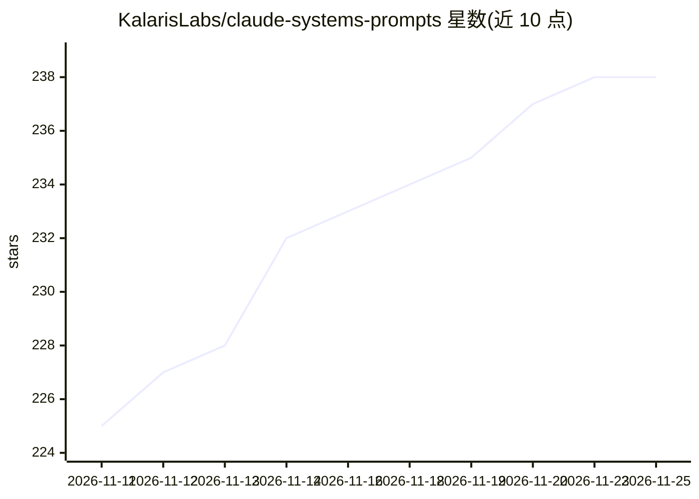

# KalarisLabs/claude-systems-prompts

⭐ 238 · NOASSERTION · 推送 2026-11-11 · [GitHub](https://github.com/KalarisLabs/claude-systems-prompts) · 个人维护

**Anthropic 官方 Claude 系统提示词存档库（23 个模型）**

由 Sayan Chowdhury 策展的 Claude 系统提示词档案库：逐字收录 Anthropic 发布于 release notes 的 23 个模型、50 个版本的官方系统提示词（claude.ai 与移动端 App，不含 API），每份附版本日期与来源链接，时间跨度 2024 年 7 月至 2026 年 11 月。另提供旗舰模型 Fable 5 完整提示词（约 1,580 行）、工具定义、章节目录、逐节分析与发现摘录。面向提示词工程师、AI 安全研究者、红队与写作者。MIT 许可，提示词内容版权归 Anthropic。

## 筛选速览

| 维度 | 判定 | 备注 |
|---|---|---|
| AI 角色 | `ai-knowledge` | 知识聚合/清单类 |
| 许可风险 | `none` | NOASSERTION |
| 部署形态 | `None` |  |
| 模型依赖 | — | README 未给出锁定关系 |
| 硬件要求 | — | 无带数字的原话,不猜 |
| 安装摩擦 | `low` | 无编译、无系统依赖或容器化 |
| 成熟度 | — | 结构信号不足 |

## 能力要点

- 23 个模型、50 个版本的官方提示词逐字存档并附来源链接
- 同一模型不同日期版本可 diff 对比
- Fable 5 完整提示词的章节目录、工具 schema 与对比分析
- highlights/ 目录汇集版权合规、心理健康协议等发现

## 适用场景

- 研究 Anthropic 如何工程化拒答、语气与工具使用策略
- 为自己的系统提示词参考生产级模式
- AI 安全研究：跟踪 50 个有日期版本间的策略漂移
- 报道或教学时引用原始提示词原文

## 场景标签

`提示工程` · 领域:Agent 开发

## 证据(README 行号)

> L3: ### A dated, exact archive of all official Anthropic system prompts for Claude, from Claude Fable 5.2 back to Claude
> L36: - **`models/`**: all 23 official system prompts, copied exactly, with latest version dates, full version history pe
> L40: **Coverage:** 23 models. 50 published prompt versions referenced. July 2024 to November 2026. Every file copied exa

## 星数曲线

2026-11-11 225 → 2026-11-25 238（+13）

---
*卡片 v1 · prompt 1.4 · 生成 2026-11-17 · 置信度 high · 依据 README sha `0e970f1d8138` · [字段定义](../../DATASET.md)*
