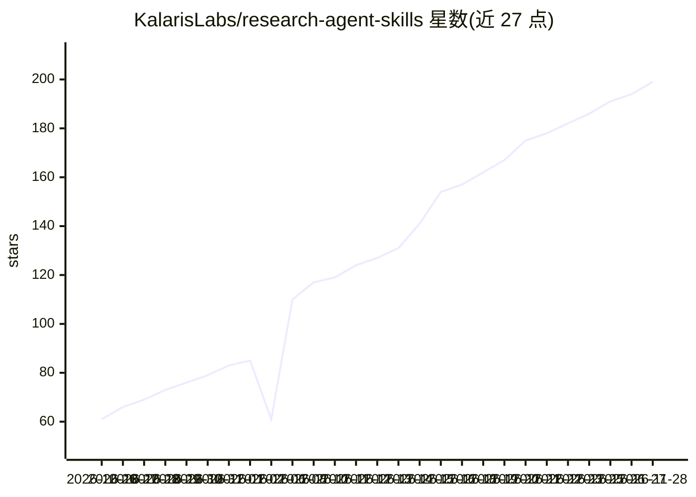

# KalarisLabs/research-agent-skills

⭐ 199 · Python · NOASSERTION · 推送 2026-11-26 · [GitHub](https://github.com/KalarisLabs/research-agent-skills) · [官网](https://docs.kalarislabs.com/research-agent-skills) · 组织维护

**面向科研场景的 280+ AI agent 技能库，覆盖文献到投稿全流程**

由 Kalaris Labs 维护的开源 agent 技能库（MIT 许可），每个技能为含 SKILL.md、参考材料与脚本的文件夹，agent 按任务按需加载。技能覆盖研究全流程：假设生成、文献综述与 PRISMA、实验设计、数据分析（scanpy/rdkit/astropy 等 150+）、写作与去 AI 痕迹、引用核验（对照 Crossref/OpenAlex/arXiv）、期刊格式与同行评审应答。通过 skills.sh CLI、pip/uv、Claude Code 插件市场等方式安装；自述模型相关基准为小样本试点，不代跑实验。

## 筛选速览

| 维度 | 判定 | 备注 |
|---|---|---|
| AI 角色 | `ai-knowledge` | 知识聚合/清单类 |
| 许可风险 | `permissive` | NOASSERTION |
| 部署形态 | `library` | 以包/库形式分发 |
| 模型依赖 | — | README 未给出锁定关系 |
| 硬件要求 | — | 无带数字的原话,不猜 |
| 安装摩擦 | `medium` | 含编译或系统依赖之一 |
| 成熟度 | — | 结构信号不足 |

## 能力要点

- 280+ 技能按研究阶段组织，agent 按需加载单个技能
- citation-verification 对每条引用核验 Crossref/OpenAlex/arXiv
- 提供 Claude Code 插件市场与按学科的字段捆绑包
- 每个 PR 运行 Cisco skill-scanner、CodeQL 与注入 linter 扫描

## 适用场景

- 让 Claude Code/Codex 等 agent 帮我做文献综述和引用核验
- 写论文时按目标期刊格式整理投稿材料并回应审稿意见
- 按学科安装捆绑包辅助数据分析与实验设计

## 场景标签

`科研工具` `数据分析` · 领域:效率与自动化

## 证据(README 行号)

> L49: **Research Agent Skills**, maintained by **Kalaris Labs**, is a free, open-source library of
> L50: agent skills that gives your AI agent the methods of a careful scientist. Each skill is a folder
> L7: ** 280+ open-source agent skills that take Claude Code, Codex, Cursor, Gemini CLI, Copilot or any Agent Skills harne

## 星数曲线

2026-10-26 61 → 2026-11-28 199（+138）

---
*卡片 v1 · prompt 1.4 · 生成 2026-11-26 · 置信度 high · 依据 README sha `940ee2ca8d4b` · [字段定义](../../DATASET.md)*
