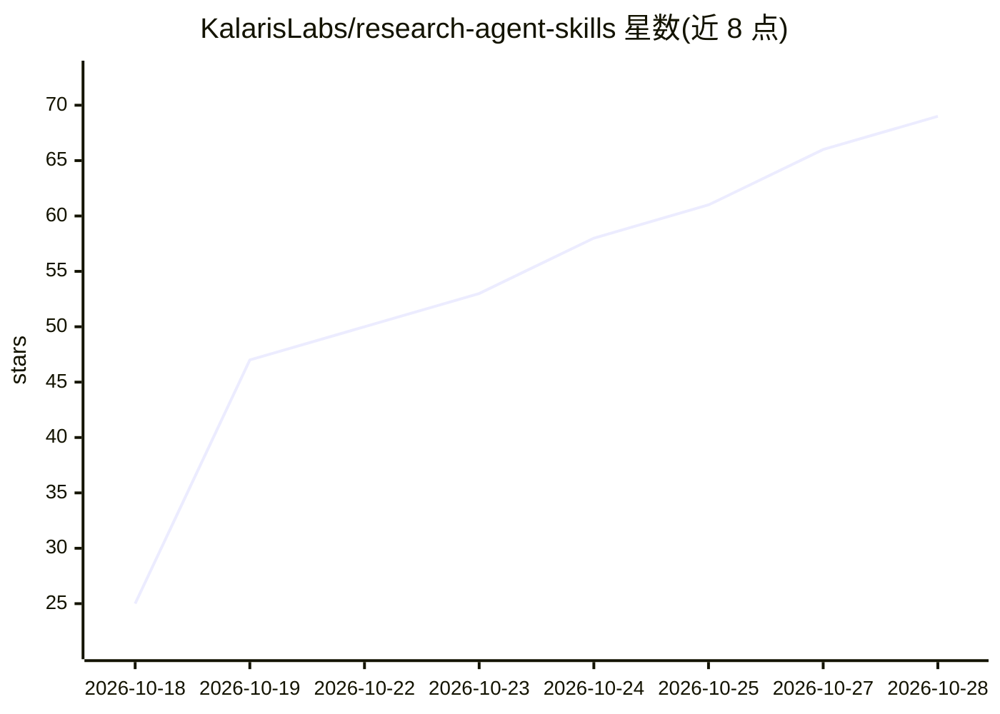

# KalarisLabs/research-agent-skills

⭐ 69 · Python · NOASSERTION · 推送 2026-10-25 · [GitHub](https://github.com/KalarisLabs/research-agent-skills) · [官网](https://docs.kalarislabs.com/research-agent-skills) · 组织维护

**面向科研的 280+ 开源 agent 技能库，覆盖文献到投稿全流程**

Kalaris Labs 维护的开源科研 agent 技能库：280+ 个技能以含 SKILL.md、参考资料与脚本的标准文件夹形式组织，覆盖选题假设、文献检索与 PRISMA 综述、实验设计、数据分析（scanpy/rdkit/astropy 等领域工具链）、学术写作去 AI 腔、引文核验（对接 Crossref/OpenAlex/arXiv）、投稿与同行评审等阶段。兼容 Claude Code、Codex、Cursor、Gemini CLI 及任何遵循 Agent Skills 规范的 harness，通过 npx skills CLI、GitHub CLI、安装脚本或 Claude Code 插件市场安装，项目本身不在 npm 上。

## 筛选速览

| 维度 | 判定 | 备注 |
|---|---|---|
| AI 角色 | `ai-knowledge` | 知识聚合/清单类 |
| 许可风险 | `permissive` | NOASSERTION |
| 部署形态 | `library` | 以包/库形式分发 |
| 模型依赖 | — | README 未给出锁定关系 |
| 硬件要求 | — | 无带数字的原话,不猜 |
| 安装摩擦 | `medium` | 含编译或系统依赖之一 |
| 成熟度 | — | 结构信号不足 |

## 能力要点

- 技能覆盖问题-文献-设计-分析-写作-核验-投稿-评审 8 个阶段
- citation-verification 对接 Crossref/OpenAlex/arXiv 核验参考文献
- unslop-academic-writing 检测并改写学术写作中的 AI 套话
- 遵循开放 Agent Skills 规范，无 SDK、无服务端依赖

## 适用场景

- 让 Claude Code/Codex 等 agent 按需加载技能完成文献综述或引文核验
- 研究生写论文时去除 AI 腔调并按期刊格式排版
- 为特定领域（ML/生物/化学/医学/物理）批量安装领域技能包

## 场景标签

`科研工具` · 领域:学习与行业

## 证据(README 行号)

> L7: ** 280+ open-source agent skills that take Claude Code, Codex, Cursor, Gemini CLI, Copilot or any Agent Skills harne
> L41: **Research Agent Skills**, maintained by **Kalaris Labs**, is a free, open-source library of
> L42: agent skills that gives your AI agent the methods of a careful scientist. Each skill is a folder

## 星数曲线

2026-10-18 25 → 2026-10-28 69（+44）

---
*卡片 v1 · prompt 1.4 · 生成 2026-10-24 · 置信度 high · 依据 README sha `a8f282a8fc51` · [字段定义](../../DATASET.md)*
