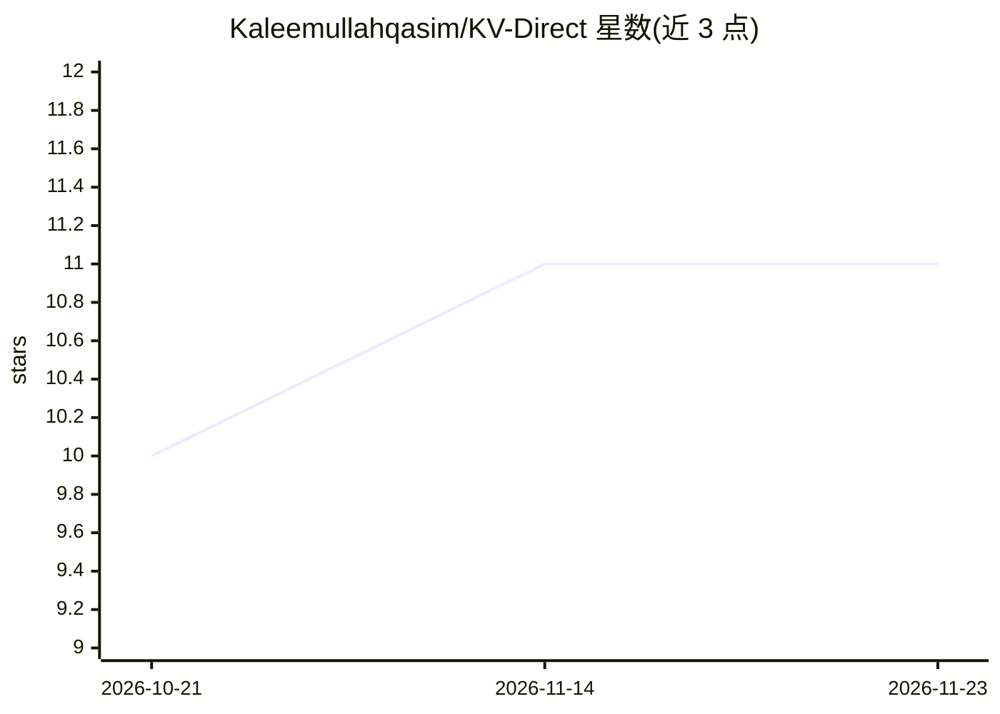

# Kaleemullahqasim/KV-Direct

⭐ 11 · MIT · 推送 2026-08-12 · [GitHub](https://github.com/Kaleemullahqasim/KV-Direct) · 组织维护 · 中文 README

**用残差流检查点替代 KV 缓存的有界内存推理研究论文**

提出 KV-Direct 方法：利用 K/V 是残差流确定性投影这一事实，被逐出的 KV 条目用每 token 一个残差检查点替代，按需精确重算，重建误差为零。论文在 4 个架构家族的 6 个模型（135M–4B 参数）上验证恒等式，报告 4B 模型下检查点 5 KB/token 对全量 KV 136 KB（约 27 倍缩减），20 轮对话峰值内存有界于 42 MB，且在所有缓存预算下保持 100% token 匹配。代码与实验脚本标注即将发布，当前仅论文形式。投稿于 Journal of Systems Architecture 审稿中。

## 筛选速览

| 维度 | 判定 | 备注 |
|---|---|---|
| AI 角色 | `ai-knowledge` | 知识聚合/清单类 |
| 许可风险 | `permissive` | MIT |
| 部署形态 | `None` |  |
| 模型依赖 | — | README 未给出锁定关系 |
| 硬件要求 | — | 无带数字的原话,不猜 |
| 安装摩擦 | `low` | 无编译、无系统依赖或容器化 |
| 成熟度 | `idea` | |

## 能力要点

- 从残差流精确重算被逐出的 KV 条目，零重建误差
- 每 token 残差检查点约 5 KB（4B 模型），约 27 倍内存缩减
- 20 轮对话峰值内存有界于 42 MB，输出与标准缓存 token 级一致

## 适用场景

- 长上下文 LLM 推理的内存受限部署研究
- KV 缓存逐出策略的实验基线对比

## 场景标签

`推理引擎` · 领域:训练与推理

## 证据(README 行号)

> L11: During autoregressive decoding, the key-value (KV) cache stores precomputed keys and values for every past token at
> L19: ## Code
> L21: Code and experimental scripts are coming soon. Stay tuned.

## 星数曲线

2026-10-21 10 → 2026-11-23 11（+1）

---
*卡片 v1 · prompt 1.4 · 生成 2026-11-19 · 置信度 high · 依据 README sha `d26fd069ab19` · [字段定义](../../DATASET.md)*
