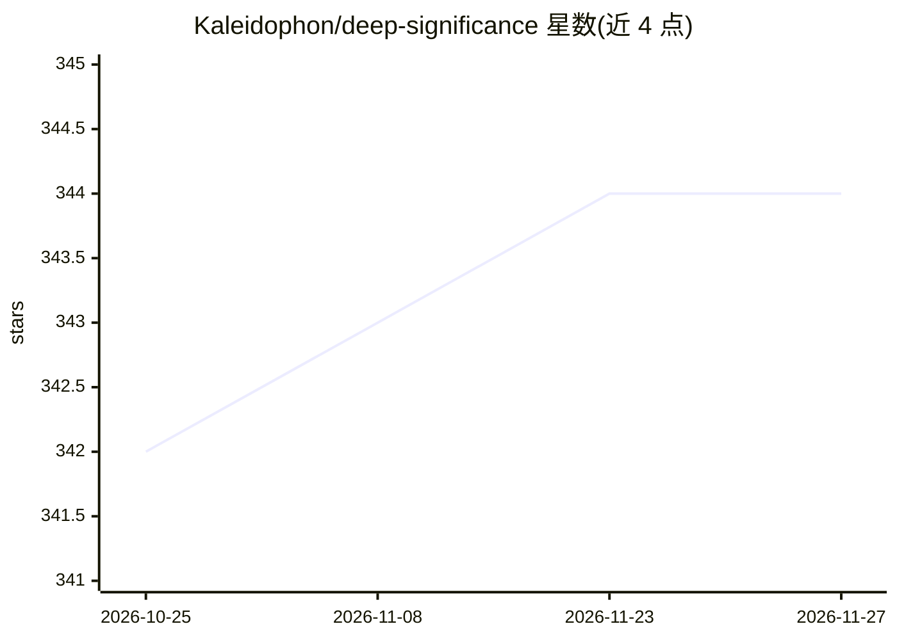

# Kaleidophon/deep-significance

⭐ 344 · Python · GPL-3.0 · 推送 2026-11-22 · [GitHub](https://github.com/Kaleidophon/deep-significance) · [官网](https://deep-significance.rtfd.io/en/latest/) · 个人维护

**面向深度学习研究者的模型分数统计显著性检验库**

提供深度神经网络实验结果的统计假设检验功能：实现 Almost Stochastic Order、bootstrap、permutation 检验，附带 Holm-Bonferroni/Bonferroni 多重比较校正、bootstrap 功效分析与样本量确定函数。所有函数经过测试，兼容 PyTorch/TensorFlow 张量及 NumPy/Jax 数组。通过 pip 安装，提供多场景示例文档与演示 notebook。适用于 NLP、强化学习、计算机视觉等领域的模型比较场景。

## 筛选速览

| 维度 | 判定 | 备注 |
|---|---|---|
| AI 角色 | `ai-ecosystem` | LLM/agent 周边工具 |
| 许可风险 | `viral` | GPL-3.0 |
| 部署形态 | `library` | 以包/库形式分发 |
| 模型依赖 | — | README 未给出锁定关系 |
| 硬件要求 | — | 无带数字的原话,不猜 |
| 安装摩擦 | `low` | 无编译、无系统依赖或容器化 |
| 成熟度 | — | 结构信号不足 |

## 能力要点

- 实现 ASO/bootstrap/permutation 三类显著性检验
- Holm-Bonferroni 与 Bonferroni 多重比较校正
- bootstrap 功效分析与样本量确定函数
- 兼容 PyTorch/TensorFlow/NumPy/Jax 数据结构

## 适用场景

- 比较两个模型多次随机种子运行的分数是否差异显著
- 跨多个数据集比较多组模型分数并做多重比较校正
- 样本级分数的逐点配对比较
- 确定实验需要的运行次数与样本量

## 场景标签

`科研工具` · 领域:学习与行业

## 证据(README 行号)

> L31: To help mitigate this problem, this package supplies fully-tested re-implementations of useful functions for signif
> L39: All functions are fully tested and also compatible with common deep learning data structures, such as PyTorch /

## 星数曲线

2026-10-25 342 → 2026-11-27 344（+2）

---
*卡片 v1 · prompt 1.4 · 生成 2026-11-25 · 置信度 high · 依据 README sha `5a3777e57e70` · [字段定义](../../DATASET.md)*
