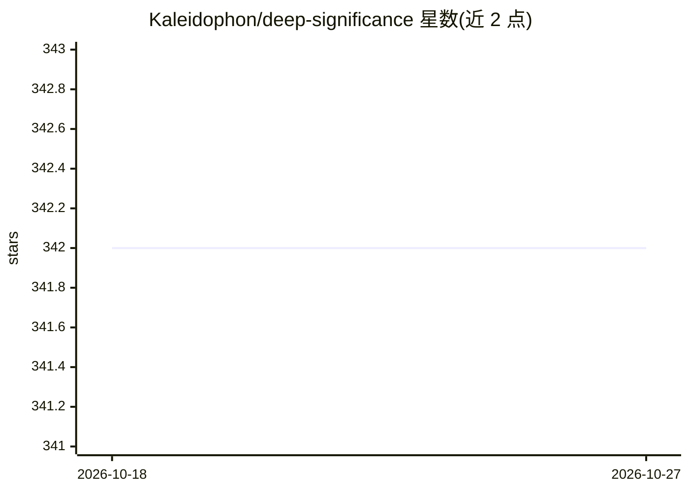

# Kaleidophon/deep-significance

⭐ 342 · Python · GPL-3.0 · 推送 2026-09-21 · [GitHub](https://github.com/Kaleidophon/deep-significance) · [官网](https://deep-significance.rtfd.io/en/latest/) · 个人维护

**深度学习模型对比的统计显著性检验库**

Python 库 deepsig，提供面向深度神经网络的统计显著性检验：核心是 Almost Stochastic Order（ASO）检验，用于比较两组模型得分分布，返回 eps_min 置信分数；另含 bootstrap、permutation-randomization 检验、Bonferroni 多重比较校正和 bootstrap 功效分析以确定样本量。函数兼容 PyTorch/TensorFlow 张量及 NumPy/Jax 数组，通过 pip 安装，面向需要严谨比较模型性能的机器学习研究者。ASO 不计算 p 值，也不对得分分布作假设。

## 筛选速览

| 维度 | 判定 | 备注 |
|---|---|---|
| AI 角色 | `ai-ecosystem` | LLM/agent 周边工具 |
| 许可风险 | `viral` | GPL-3.0 |
| 部署形态 | `library` | 以包/库形式分发 |
| 模型依赖 | — | README 未给出锁定关系 |
| 硬件要求 | — | 无带数字的原话,不猜 |
| 安装摩擦 | `low` | 无编译、无系统依赖或容器化 |
| 成熟度 | — | 结构信号不足 |

## 能力要点

- ASO 检验比较两组得分分布，返回 eps_min 置信分数
- 支持 bootstrap、permutation-randomization 与 Bonferroni 校正
- multi_aso() 对多模型两两比较并默认做多重比较校正
- 兼容 PyTorch/TensorFlow 张量与 NumPy/Jax 数组

## 适用场景

- 比较多随机种子下两个模型的得分是否显著差异
- 跨数据集比较多模型并控制多重比较问题
- 论文中按规范报告 ASO 置信水平与 eps_min 分数

## 场景标签

`模型评测` · 领域:评测与运维

## 证据(README 行号)

> L31: To help mitigate this problem, this package supplies fully-tested re-implementations of useful functions for signif
> L38: All functions are fully tested and also compatible with common deep learning data structures, such as PyTorch /

## 星数曲线

2026-10-18 342 → 2026-10-27 342（+0）

---
*卡片 v1 · prompt 1.4 · 生成 2026-10-22 · 置信度 high · 依据 README sha `653e498db7f5` · [字段定义](../../DATASET.md)*
