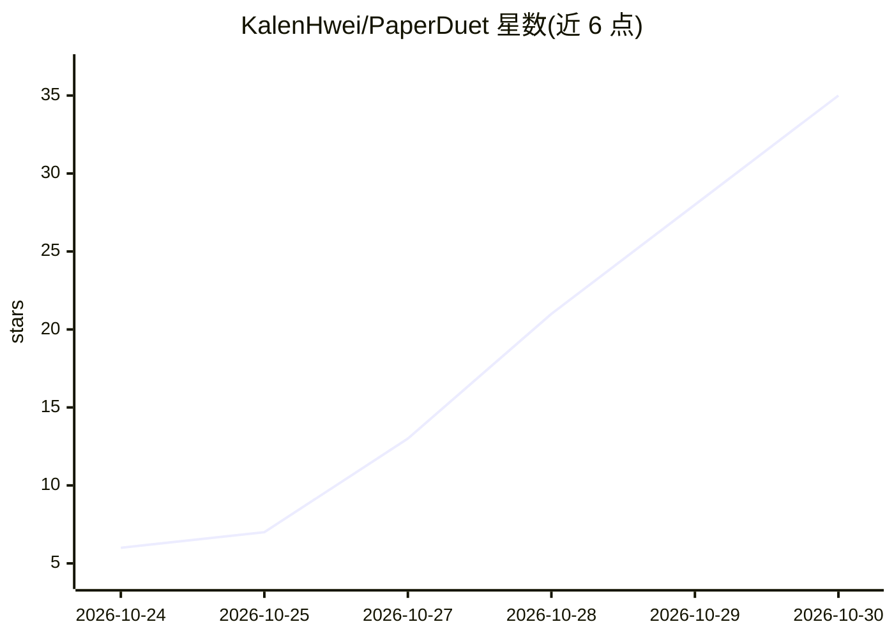

# KalenHwei/PaperDuet

⭐ 35 · NOASSERTION · 推送 2026-10-29 · [GitHub](https://github.com/KalenHwei/PaperDuet) · [官网](https://paperduet.com) · 个人维护 · 中文 README

**面向科研人员的本地 AI 论文翻译器，原文与译文镜像对照**

Mac/Windows 桌面应用，将 PDF 论文原文与译文左右镜像排版，公式、图表、表格逐页对齐，支持译入十种语言。翻译由本地模型完成，内置五个开源翻译模型可选（bilibili Index、腾讯混元、NiuTrans、Google TranslateGemma），也可切换为用户自有 API key（OpenAI/Claude/DeepSeek/Qwen 等）。另提供 AI 摘要、AI 搜索、按领域整理文献库、标注笔记与双语导出。许可证为 PolyForm Noncommercial，商用需另行购买商业许可。

## 筛选速览

| 维度 | 判定 | 备注 |
|---|---|---|
| AI 角色 | `ai-native` | 本体是模型或模型工具 |
| 许可风险 | `none` | NOASSERTION |
| 部署形态 | `desktop` | 安装包/桌面程序 |
| 模型依赖 | — | README 未给出锁定关系 |
| 硬件要求 | — | 无带数字的原话,不猜 |
| 安装摩擦 | `low` | 无编译、无系统依赖或容器化 |
| 成熟度 | — | 结构信号不足 |

## 能力要点

- 原文与译文镜像排版，公式图表逐页对齐
- 5 个本地翻译模型可选，完全离线运行，无需 API key
- 可检测并复用 LM Studio/llama.cpp/Hugging Face 已有模型文件
- AI 摘要、AI 搜索与文献库按领域自动整理

## 适用场景

- 阅读外文论文时逐段对照翻译，保留公式与排版
- 整理已读论文并按主题、内容检索
- 在译文上做高亮笔记并回写导出到原 PDF

## 场景标签

`科研工具` · 领域:学习与行业

## 证据(README 行号)

> L20:  PaperDuet is a lightweight AI mirror translator for papers that keeps the original layout.
> L27: PaperDuet is a lightweight AI mirror translator for papers. It lays out the original and the translation as mirror 
> L76: Pick a model the first time you open PaperDuet, and switch anytime in Settings › Model › Change Model. Every one of

## 星数曲线

2026-10-24 6 → 2026-10-30 35（+29）

---
*卡片 v1 · prompt 1.4 · 生成 2026-10-28 · 置信度 high · 依据 README sha `2ce786e73787` · [字段定义](../../DATASET.md)*
