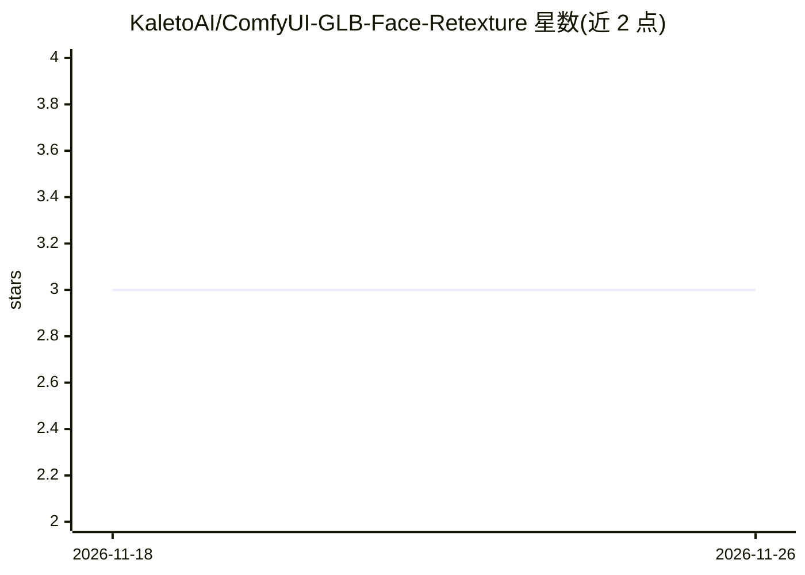

# KaletoAI/ComfyUI-GLB-Face-Retexture

⭐ 3 · Python · Apache-2.0 · 推送 2026-11-15 · [GitHub](https://github.com/KaletoAI/ComfyUI-GLB-Face-Retexture) · 组织维护

**ComfyUI 节点：将人脸照片投影到 GLB 网格面部纹理**

作为 ComfyUI 自定义节点，把匹配的 RGB 人脸照片投影到已有静态 GLB 的可见面部纹理上，使用面部关键点与语义掩码进行注册与融合，不重建或变形网格几何体；提供 light_balance（去大块阴影）、tone_match（肤色匹配）、skin_recolor（整体皮肤色调校正）、seam_blend（接缝混合）等控制项。要求较新版本 ComfyUI（验证于 0.37.0）与独立 Python 3.12 CPU worker 环境；Windows GUI 会话尚未验证，输入的 GLB 与照片需用户自备。

## 筛选速览

| 维度 | 判定 | 备注 |
|---|---|---|
| AI 角色 | `ai-native` | 本体是模型或模型工具 |
| 许可风险 | `permissive` | Apache-2.0 |
| 部署形态 | `desktop` | 安装包/桌面程序 |
| 模型依赖 | — | README 未给出锁定关系 |
| 硬件要求 | — | 无带数字的原话,不猜 |
| 安装摩擦 | `low` | 无编译、无系统依赖或容器化 |
| 成熟度 | — | 结构信号不足 |

## 能力要点

- 基于面部关键点与语义掩码的照片投影，几何体完全保留
- light_balance/tone_match/skin_recolor 三级肤色校正管线
- CPU worker 运行于独立 .venv，不污染 ComfyUI 环境
- 输出附带 ΔE 等测量证明记录（proof）

## 适用场景

- 修复 image-to-3D 生成网格（如 Trellis）上模糊的面部纹理
- 校正生成网格整体偏红的皮肤色调
- 在不改动网格几何的前提下替换 3D 角色的脸部

## 场景标签

 · 领域:3D 生成/图像处理

## 证据(README 行号)

> L3: Project a matching RGB face photo onto the visible face texture of an existing static GLB. **GLB Face Retexture (Pre
> L13: - A modern ComfyUI with native `Load3DAdvanced`, `Preview3DAdvanced`, `SaveGLB` and `comfy_api.latest.Types.File3D`
> L20: Worker dependency selection uses standard pip platform markers: **Linux ARM64** (`sys_platform == "linux"` and `pla

## 星数曲线

2026-11-18 3 → 2026-11-26 3（+0）

---
*卡片 v1 · prompt 1.4 · 生成 2026-11-26 · 置信度 mid · 依据 README sha `9d36141859f1` · [字段定义](../../DATASET.md)*
