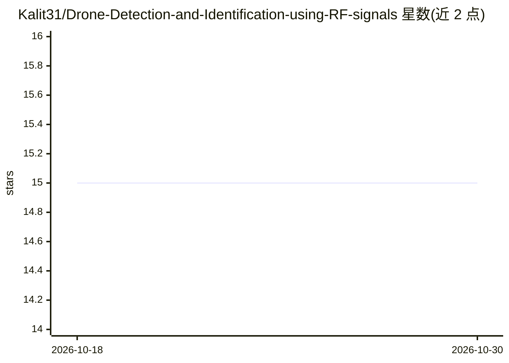

# Kalit31/Drone-Detection-and-Identification-using-RF-signals

⭐ 15 · Jupyter Notebook · MIT · 推送 2026-01-12 · [GitHub](https://github.com/Kalit31/Drone-Detection-and-Identification-using-RF-signals) · [官网](https://ieeexplore.ieee.org/abstract/document/10068637) · 个人维护

**基于 RF 信号的无人机检测与识别机器学习框架**

论文配套代码仓库：在 DroneRF 数据集上，用功率谱密度技术从原始 RF 数据提取特征，训练 XGBoost 分类器（2/4/10 类准确率 100%/100%/99.73%）；另开展特征融合实验、1DCNN 深度学习实验，以及 1DCNN 特征提取器加 XGBoost 分类器的混合方法（准确率 100%/99.82%/99.51%）。数据集为 DroneRF，数据通过 Google Drive 链接提供。面向无人机安全检测方向的科研人员。

## 筛选速览

| 维度 | 判定 | 备注 |
|---|---|---|
| AI 角色 | `ai-native` | 本体是模型或模型工具 |
| 许可风险 | `permissive` | MIT |
| 部署形态 | `None` |  |
| 模型依赖 | — | README 未给出锁定关系 |
| 硬件要求 | — | 无带数字的原话,不猜 |
| 安装摩擦 | `low` | 无编译、无系统依赖或容器化 |
| 成熟度 | — | 结构信号不足 |

## 能力要点

- 功率谱密度特征提取 + XGBoost 分类（2/4/10 类）
- 1DCNN 深度学习实验路径
- 1DCNN 特征提取 + XGBoost 分类器的混合方法

## 适用场景

- 复现论文中基于 RF 信号的无人机检测实验
- 在 DroneRF 数据集上对比机器学习与深度学习方法

## 场景标签

`网络安全` · 领域:学习与行业

## 证据(README 行号)

> L3: The recent advancement in the state of art technologies for drones and their reduced cost have made them highly acce

## 星数曲线

2026-10-18 15 → 2026-10-30 15（+0）

---
*卡片 v1 · prompt 1.4 · 生成 2026-10-30 · 置信度 high · 依据 README sha `9347b81828b8` · [字段定义](../../DATASET.md)*
