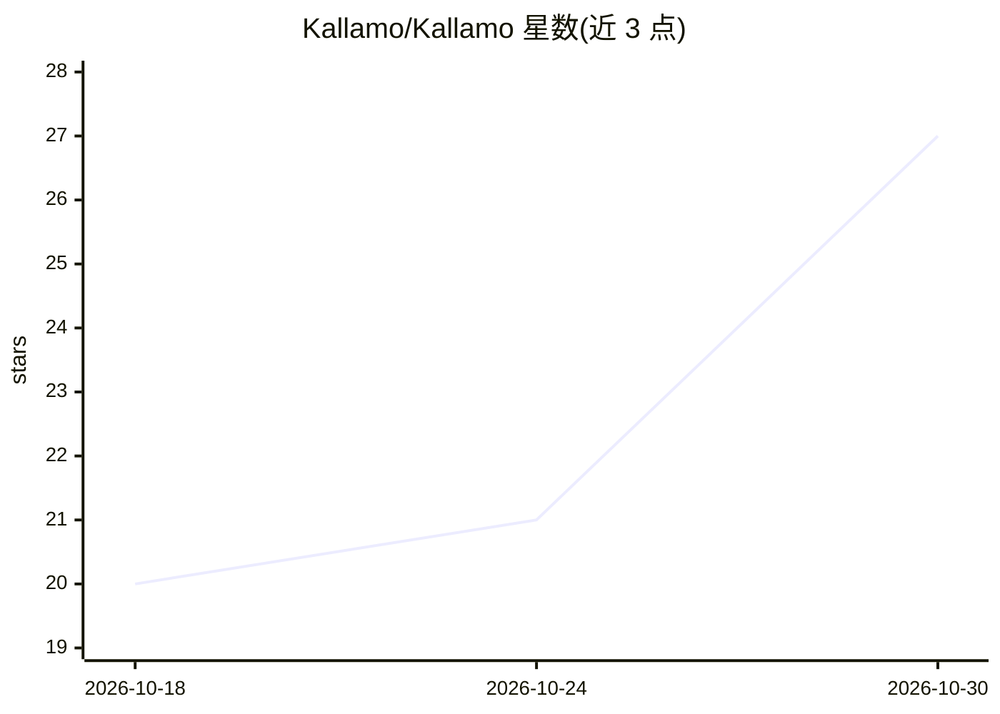

# Kallamo/Kallamo

⭐ 27 · JavaScript · AGPL-3.0 · 推送 2026-10-29 · [GitHub](https://github.com/Kallamo/Kallamo) · [官网](https://kallamo.com) · 组织维护

**BYOK 桌面平台：构建 AI 人设、知识库与多步工作流**

基于 Electron/React/SQLite 的本地优先桌面应用：用户自带 API 密钥接入多家 LLM 提供商，创建自定义 AI 人设，为其挂接本地混合 RAG 知识库（multilingual-e5-small 嵌入 + FTS5 BM25），将多个角色链成顺序工作流，并自动归档向量化旧对话以保持记忆。内置长文写作台、实体世界索引与可移植的配置包导出。面向非编程用户（写作者、游戏主持人、项目经理等），提供 Windows/macOS/Linux 安装包，AGPL v3 许可。

## 筛选速览

| 维度 | 判定 | 备注 |
|---|---|---|
| AI 角色 | `ai-native` | 本体是模型或模型工具 |
| 许可风险 | `viral` | AGPL-3.0 |
| 部署形态 | `desktop` | 安装包/桌面程序 |
| 模型依赖 | local-ok | 支持本地模型 |
| 硬件要求 | — | 无带数字的原话,不猜 |
| 安装摩擦 | `medium` | 含编译或系统依赖之一 |
| 成熟度 | — | 结构信号不足 |

## 能力要点

- 多提供商 BYOK API 引擎（OpenAI/Anthropic/Google/Vertex/Bedrock/OpenRouter/Ollama/LM Studio），密钥本地加密存储
- 本地混合 RAG：密集向量 + BM25 稀疏检索，支持 Agentic 检索规划模式
- 多角色顺序工作流链，每步独立提示词、模型与知识库
- 对话超阈值自动归档为可语义检索的记忆块

## 适用场景

- 为写作、跑团、项目管理等场景构建带个人知识库的 AI 人设
- 把多个 AI 角色串成研究→分析→起草→审阅的多步流程
- 长文档写作时选段让 AI 改写并以 diff 方式审阅

## 场景标签

`工作流自动化` `RAG` `AI 写作` · 领域:效率与自动化

## 证据(README 行号)

> L5: A **bring-your-own-key** desktop platform that puts you in full control of AI — build custom personas, feed them you
> L80: Kallamo doesn't sell AI access — you connect your own API keys. Support for **OpenAI**, **Anthropic**, **Google AI*

## 星数曲线

2026-10-18 20 → 2026-10-30 27（+7）

---
*卡片 v1 · prompt 1.4 · 生成 2026-10-28 · 置信度 mid · 依据 README sha `80e1026b3a0d` · [字段定义](../../DATASET.md)*
