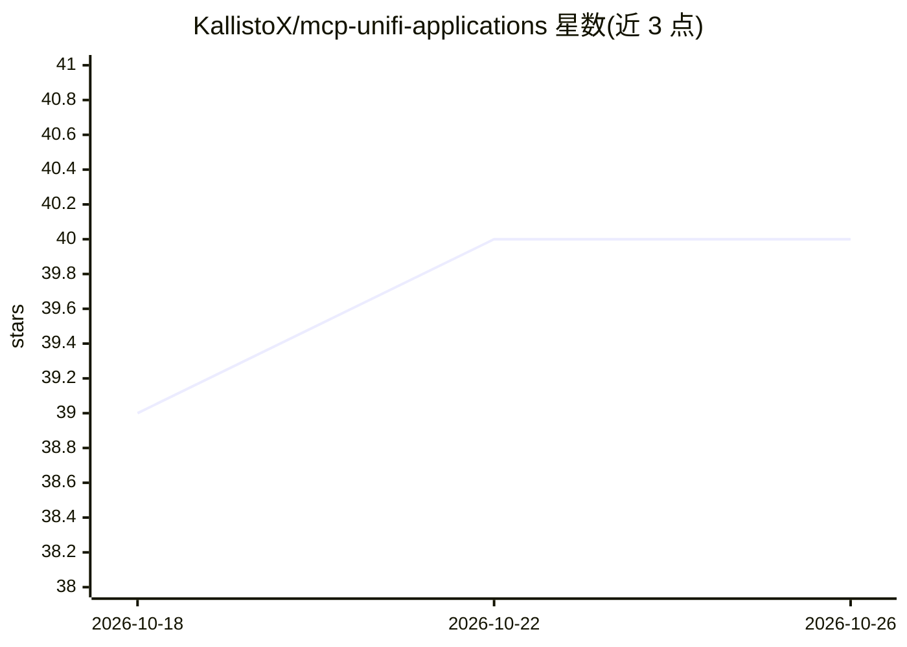

# KallistoX/mcp-unifi-applications

⭐ 40 · Python · MIT · 推送 2026-10-16 · [GitHub](https://github.com/KallistoX/mcp-unifi-applications) · [官网](https://pypi.org/project/mcp-unifi-applications/) · 个人维护

**让 AI agent 查询 UniFi 官方 API 文档的 MCP 服务器**

一个 Model Context Protocol 服务器，把 Ubiquiti 官方 UniFi API 文档（Network、Protect、Site Manager、InnerSpace、Mobility、Carrier Fabric）以结构化 JSON 形式提供给 AI agent 查询：端点模糊搜索、端点全量 schema、按字段下钻取子树、五种语言的代码示例（curl/Go/Node.js/Python/Ansible）与响应样例、指南页读取。只读且无需控制器凭据，抓取好的文档随 pip 包分发，无需抓取或配置 API key；另含基于 Playwright 的文档抓取器供更新文档使用（需 Docker/Chromium）。适用于 Claude Desktop、Claude Code 及任意 MCP 兼容客户端。

## 筛选速览

| 维度 | 判定 | 备注 |
|---|---|---|
| AI 角色 | `ai-ecosystem` | LLM/agent 周边工具 |
| 许可风险 | `permissive` | MIT |
| 部署形态 | `self-host` | docker 或自建部署 |
| 模型依赖 | — | README 未给出锁定关系 |
| 硬件要求 | — | 无带数字的原话,不猜 |
| 安装摩擦 | `low` | 无编译、无系统依赖或容器化 |
| 成熟度 | — | 结构信号不足 |

## 能力要点

- 10 个 MCP 工具覆盖端点搜索、schema 下钻、代码示例与指南页
- 只读、无需控制器凭据，不接触用户网络
- get_field_schema 可只取单个字段子树而非完整端点 schema
- 每个端点携带 5 种语言代码示例与响应样例

## 适用场景

- 让 Claude 等 agent 在编码时查询 UniFi API 的端点与字段结构
- 开发 UniFi 集成前无需阅读全量文档即可获得字段级答案
- 配合控制面 MCP 服务器，一个讲解 API、一个调用 API

## 场景标签

 · 领域:开发者工具/API 文档

## 证据(README 行号)

> L8: A Model Context Protocol (MCP) server that makes the official UniFi API documentation queryable by AI agents — endpo
> L105: Most UniFi MCP servers are **control planes**: they authenticate against your controller and expose tools that rea
> L139: ## Available Tools

## 星数曲线

2026-10-18 39 → 2026-10-26 40（+1）

---
*卡片 v1 · prompt 1.4 · 生成 2026-10-25 · 置信度 mid · 依据 README sha `423f88bbbf4e` · [字段定义](../../DATASET.md)*
