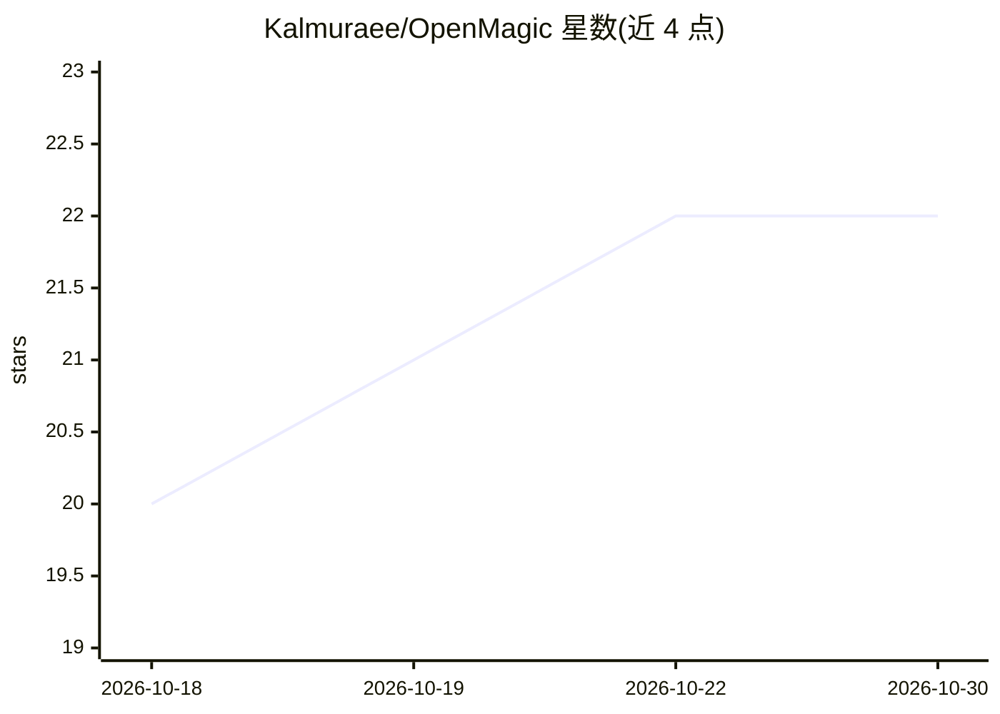

# Kalmuraee/OpenMagic

⭐ 22 · TypeScript · MIT · 推送 2026-09-19 · [GitHub](https://github.com/Kalmuraee/OpenMagic) · [官网](https://kalmuraee.github.io/OpenMagic/) · 个人维护 · 中文 README

**给前端开发者的浏览器内 AI 编码工具栏：选元素、描述改动、改源码**

OpenMagic 通过反向代理向运行中的 Web 应用注入浮动 AI 工具栏：点击页面元素、用自然语言描述修改，经 diff 预览确认后由本地 Node.js 进程直接修改真实源码，依赖开发服务器 HMR 刷新。每次修改经 typecheck/lint 与运行时验证并可自动回滚，另提供可视化 CSS/文本/属性实时编辑与一键 AI UI/UX 设计审查。支持 14 个 LLM 提供商、70+ 模型，BYOK，密钥仅存本地。要求 Node.js 20.19+，仅限开发环境使用。

## 筛选速览

| 维度 | 判定 | 备注 |
|---|---|---|
| AI 角色 | `ai-native` | 本体是模型或模型工具 |
| 许可风险 | `permissive` | MIT |
| 部署形态 | `library` | 以包/库形式分发 |
| 模型依赖 | local-ok | 支持本地模型 |
| 硬件要求 | — | 无带数字的原话,不猜 |
| 安装摩擦 | `low` | 无编译、无系统依赖或容器化 |
| 成熟度 | — | 结构信号不足 |

## 能力要点

- 反向代理注入工具栏，零代码改动、无需框架插件或 IDE 扩展
- 修改以 diff 预览呈现，经 typecheck/lint 与运行时验证，破坏可自动回滚
- 支持 14 个提供商 70+ 模型（OpenAI/Claude/Gemini/DeepSeek/Ollama 等），BYOK
- 可视化元素编辑与一键 AI UI/UX 设计审查

## 适用场景

- 在运行中的页面里点选元素直接改源码，不用翻找文件
- 让 AI 审查界面层级、间距、对比度与可访问性并提出修改
- 用本地 Ollama 模型免费私密地做 AI 编码修改

## 场景标签

`编码 Agent` · 领域:编码与开发

## 证据(README 行号)

> L18: Select any element, describe what you want, review the diff, approve — your code updates and HMR refreshes the page
> L21: It's the **AI coding agent that edits your real source from the browser** — every change is **verified (typecheck/l

## 星数曲线

2026-10-18 20 → 2026-10-30 22（+2）

---
*卡片 v1 · prompt 1.4 · 生成 2026-10-27 · 置信度 high · 依据 README sha `27ab07cfb38e` · [字段定义](../../DATASET.md)*
