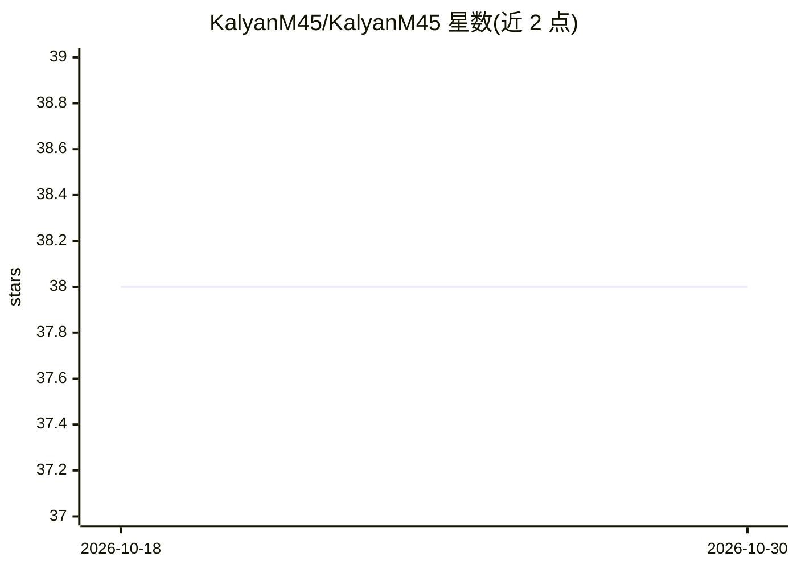

# KalyanM45/KalyanM45

⭐ 38 · 推送 2026-06-24 · [GitHub](https://github.com/KalyanM45/KalyanM45) · [官网](https://kalyanm45.github.io) · 个人维护

**个人 GitHub 主页 README：AI/ML 从业者自我介绍与作品导航**

这不是软件项目，而是 Hema Kalyan（KalyanM45）的个人 GitHub Profile README：自述 3 年以上 AI/ML 模型构建与部署经验，现任 ZoomRx Product Associate；页面列出兴趣方向（面向开发者与学生的 AI 工具、医疗与金融教育、社区协作）、简历/Medium/LinkedIn 链接、GitHub Sponsors 赞助入口、项目主题涵盖 Web 爬取、聊天机器人、NLP 与计算机视觉，并嵌入 GitHub 统计卡片。无可安装或运行的代码。

## 筛选速览

| 维度 | 判定 | 备注 |
|---|---|---|
| AI 角色 | `ai-knowledge` | 知识聚合/清单类 |
| 许可风险 | `none` | — |
| 部署形态 | `None` |  |
| 模型依赖 | — | README 未给出锁定关系 |
| 硬件要求 | — | 无带数字的原话,不猜 |
| 安装摩擦 | `low` | 无编译、无系统依赖或容器化 |
| 成熟度 | — | 结构信号不足 |

## 能力要点

- 个人简介与经历自述（AI/ML 3 年+，ZoomRx Product Associate）
- 指向简历、Medium 博客与 LinkedIn 的链接
- 列出的端到端项目方向：Web 爬取、聊天机器人、NLP、计算机视觉

## 适用场景

- 了解该开发者的背景与开源项目入口
- 通过链接跳转其机器学习与 AI 项目仓库

## 场景标签

 · 领域:个人主页/开发者介绍

## 证据(README 行号)

> L1: Hi there, I'm Hema Kalyan👋
> L3: I'm an Artificial Intelligence and Machine Learning professional with 3+ years of hands-on experience in innovating 
> L32: * Check out my Projects: Machine Learning and AI Projects

## 星数曲线

2026-10-18 38 → 2026-10-30 38（+0）

---
*卡片 v1 · prompt 1.4 · 生成 2026-10-25 · 置信度 low · 依据 README sha `37d6ab8254d0` · [字段定义](../../DATASET.md)*
