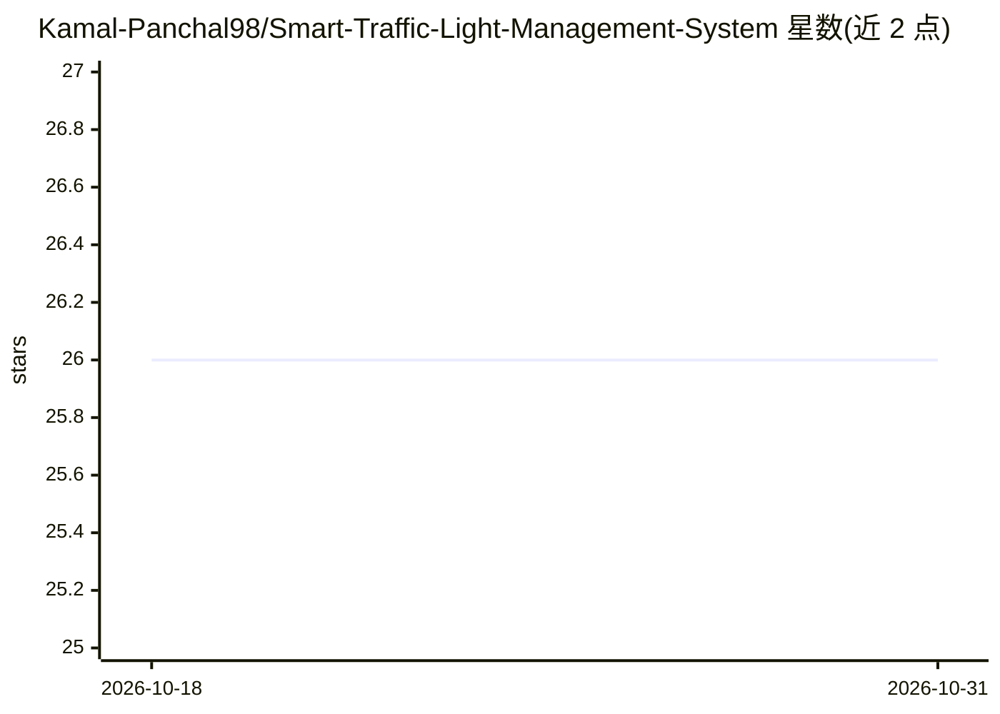

# Kamal-Panchal98/Smart-Traffic-Light-Management-System

⭐ 26 · Python · 推送 2026-09-20 · [GitHub](https://github.com/Kamal-Panchal98/Smart-Traffic-Light-Management-System) · 个人维护

**用强化学习在 SUMO 仿真中优化交通信号配时的项目**

基于 SUMO 交通仿真环境训练强化学习模型，根据各方向排队车辆数决定绿灯方向，目标降低路网总等待时间。工作流包括：用 netedit 建路网并生成车流路线，python train.py 训练模型，之后分别运行训练后模型与 without_training.py 基线仿真对比拥堵与等待时间，另提供 Tableau 仪表盘可视化结果。训练采用固定伪随机交通场景以保证实验可复现。定位为学术工程项目，收录于作者工程作品集，未来改进项含多路口协调与实时数据接入。

## 筛选速览

| 维度 | 判定 | 备注 |
|---|---|---|
| AI 角色 | `ai-native` | 本体是模型或模型工具 |
| 许可风险 | `none` | — |
| 部署形态 | `library` | 以包/库形式分发 |
| 模型依赖 | — | README 未给出锁定关系 |
| 硬件要求 | — | 无带数字的原话,不猜 |
| 安装摩擦 | `low` | 无编译、无系统依赖或容器化 |
| 成熟度 | — | 结构信号不足 |

## 能力要点

- 强化学习模型按各方向等待车辆数选择绿灯方向
- SUMO 仿真环境中训练前后对比（总等待时间）
- 固定伪随机交通场景保证实验可复现
- Tableau 仪表盘可视化仿真结果

## 适用场景

- 在 SUMO 中训练并评估交通信号强化学习控制策略
- 对比固定配时与 RL 配时的拥堵与等待时间
- 作为强化学习交通仿真的学习/课程项目参考

## 场景标签

`强化学习` · 领域:训练与推理

## 证据(README 行号)

> L3: An intelligent traffic signal optimization system that uses **Reinforcement Learning** and **SUMO (Simulation of Urb
> L28: 3. The reinforcement learning model receives the traffic state as input.

## 星数曲线

2026-10-18 26 → 2026-10-31 26（+0）

---
*卡片 v1 · prompt 1.4 · 生成 2026-10-26 · 置信度 mid · 依据 README sha `c7592d613eda` · [字段定义](../../DATASET.md)*
