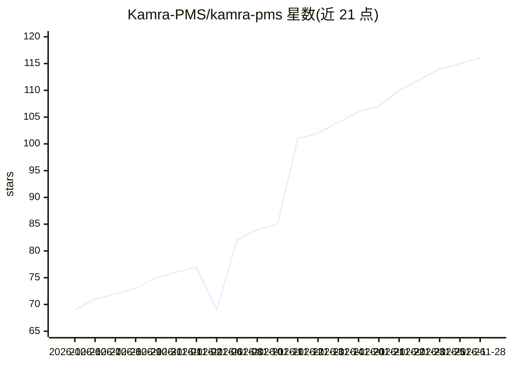

# Kamra-PMS/kamra-pms

⭐ 116 · Python · Apache-2.0 · 推送 2026-11-27 · [GitHub](https://github.com/Kamra-PMS/kamra-pms) · [官网](https://kamrapms.com) · 组织维护 · 中文 README

**给酒店/度假村的开源免费 PMS，前台、账务、POS 一体**

基于 Frappe 构建的酒店物业管理系统的完整套件，覆盖前台入住/退房、房态板、客房清洁、账单与税务、夜审、餐厅 POS、宴会管理、自助预订页与渠道管理适配器（Channex.io、STAAH、AioSell）。内置多国税务合规模块（印度 GST、沙特 ZATCA 等 11 地）。AI 部分：应用内 Kamra Agent 助手与 178 个 MCP 工具，使 Claude 或 ChatGPT 能以与员工相同的权限操作前台；所有调用经统一权限与日志控制。Apache-2.0，可自托管、Frappe Cloud 或托管安装。

## 筛选速览

| 维度 | 判定 | 备注 |
|---|---|---|
| AI 角色 | `ai-enhanced` | 去掉 AI 部分产品仍成立 |
| 许可风险 | `permissive` | Apache-2.0 |
| 部署形态 | `None` |  |
| 模型依赖 | local-ok | 支持本地模型 |
| 硬件要求 | — | 无带数字的原话,不猜 |
| 安装摩擦 | `low` | 无编译、无系统依赖或容器化 |
| 成熟度 | `idea` | |

## 能力要点

- 178 个 MCP 工具，Claude/ChatGPT 可作为前台操作员使用
- 单一写路径：UI、REST API、Agent 与 MCP 客户端共用同一受治理函数，全部进 Activity Log
- 自带免佣预订引擎 /book 与三个渠道管理适配器
- 按国家打包的税务与发票合规模块

## 适用场景

- 独立酒店/度假村替换按房收费的商业 PMS
- 让 Claude 或 ChatGPT 代办入住、收款、开账单等前台操作
- 自营渠道直连 Booking.com、Expedia、Airbnb 等 OTA
- 多国物业的本地化税务与发票合规

## 场景标签

`AI 助手` · 领域:对话与助手

## 证据(README 行号)

> L6:  A complete property management system for hotels, resorts, villas and short-term rentals.
> L96: - Kamra Agent, the in-app assistant, with action cards to check in, collect or open a folio.
> L114: - **One write path.** The desk, the REST API, Kamra Agent and MCP clients all call the same governed functions. Ea

## 星数曲线

2026-10-26 69 → 2026-11-28 116（+47）

---
*卡片 v1 · prompt 1.4 · 生成 2026-11-28 · 置信度 high · 依据 README sha `700be6db68de` · [字段定义](../../DATASET.md)*
