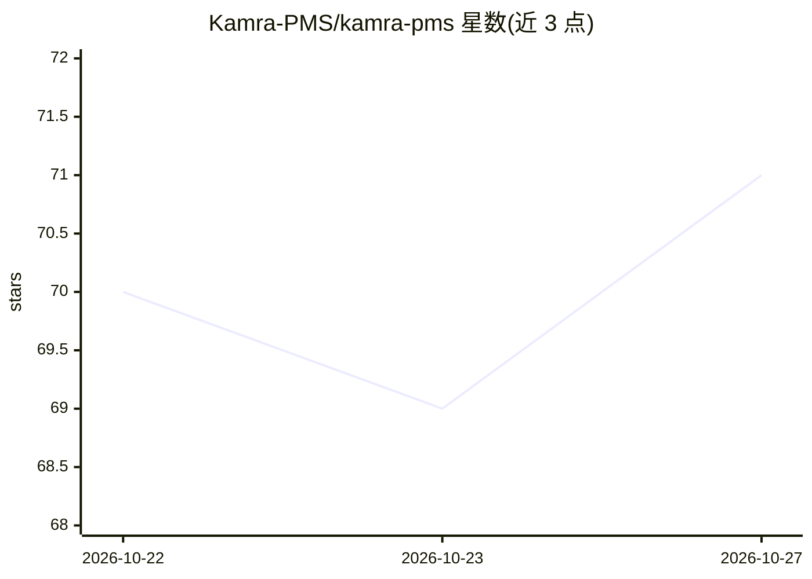

# Kamra-PMS/kamra-pms

⭐ 71 · Python · AGPL-3.0 · 推送 2026-10-26 · [GitHub](https://github.com/Kamra-PMS/kamra-pms) · [官网](https://kamrapms.com) · 组织维护

**开源酒店/民宿 PMS：前台、账务、POS 与供 AI 代理调用的 MCP 层**

面向酒店、度假村与短租别墅的开源物业管理系统（AGPL-3.0），构建于 Frappe 框架，覆盖前台、预订引擎、folio 与税务账单、客房清洁、餐饮 POS、多国税务包（印度 GST、沙特 ZATCA 等）与隐私合规（DPDP/GDPR 友好）。提供 267 个 REST 端点与含 101 个工具的 MCP 服务器，使 Claude 等 AI 代理经 RBAC 权限检查与日志审计运行物业操作；金额计算由代码（Decimal）完成而非 LLM。自带 React 前端 SPA 与 CI 评测，可自托管或经 Frappe Cloud 部署。

## 筛选速览

| 维度 | 判定 | 备注 |
|---|---|---|
| AI 角色 | `ai-enhanced` | 去掉 AI 部分产品仍成立 |
| 许可风险 | `viral` | AGPL-3.0 |
| 部署形态 | `None` |  |
| 模型依赖 | — | README 未给出锁定关系 |
| 硬件要求 | — | 无带数字的原话,不猜 |
| 安装摩擦 | `medium` | 含编译或系统依赖之一 |
| 成熟度 | — | 结构信号不足 |

## 能力要点

- 101 个 MCP 治理工具：角色限定、模块门控、权限检查、全程日志
- 费率/税额/房态由代码计算，AI 代理不可编造金额
- 6 国税务包 + 通用单一税率回退（GST/VAT/SST/PB1/ZATCA）
- 267 个 REST 端点，人类与 AI 代理共用同一治理 API 层

## 适用场景

- 酒店/民宿替代按房间收费的封闭 SaaS PMS，自托管掌控数据
- 让 Claude 等 AI 代理按权限执行订房、夜审、账务等物业操作
- 短租别墅组合用同一系统管理挂牌、押金与即时/请求预订
- 按国家合规开票：印度 GSTR-1、沙特 ZATCA 电子发票

## 场景标签

 · 领域:酒店/物业管理系统

## 证据(README 行号)

> L24: **Kamra** is a full **property management system (PMS)** for hotels, resorts, and **short-term rentals / villas**. 
> L59: - **Agent-ready, not agent-locked.** MCP server with **101** governed tools: role-scoped, module-gated, permission-
> L61: - **Deterministic money.** Rates, tax slabs, availability, and no-overbooking guards come from code, never from a l

## 星数曲线

2026-10-22 70 → 2026-10-27 71（+1）

---
*卡片 v1 · prompt 1.4 · 生成 2026-10-24 · 置信度 high · 依据 README sha `41101cdcb534` · [字段定义](../../DATASET.md)*
