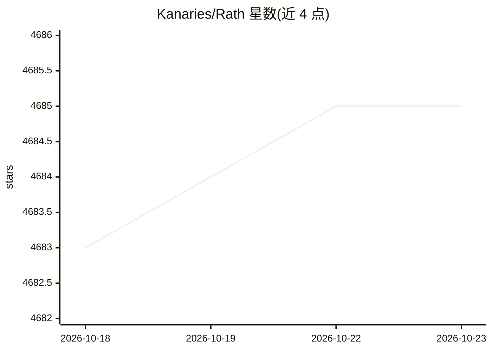

# Kanaries/Rath

⭐ 4,685 · TypeScript · AGPL-3.0 · 推送 2026-08-14 · [GitHub](https://github.com/Kanaries/Rath) · [官网](https://rath.kanaries.net) · 组织维护 · 中文 README

**自动化探索性数据分析与可视化平台，面向数据分析用户**

开源的自动 EDA 与数据可视化平台，定位为 Tableau 类工具的开源替代。核心由增强分析引擎驱动：一键自动发现数据中的模式、洞察与因果关系，并自动生成多维可视化；同时提供 Copilot 式推荐、自然语言问答（集成 GPT 生成答案与图表）、Data Painter 交互式涂色分析、自动数据清洗转换建议、仪表盘构建，以及含因果发现与 what-if 分析的因果分析模块（Alpha 阶段）。支持 CSV/JSON 文件与 Athena、Spark、ClickHouse、MySQL 等多种数据库接入；手动探索模块 Graphic Walker 可作为独立 npm 组件嵌入其他应用。软件处于 open alpha 阶段。

## 筛选速览

| 维度 | 判定 | 备注 |
|---|---|---|
| AI 角色 | `ai-enhanced` | 去掉 AI 部分产品仍成立 |
| 许可风险 | `viral` | AGPL-3.0 |
| 部署形态 | `library` | 以包/库形式分发 |
| 模型依赖 | — | README 未给出锁定关系 |
| 硬件要求 | — | 无带数字的原话,不猜 |
| 安装摩擦 | `low` | 无编译、无系统依赖或容器化 |
| 成熟度 | `idea` | |

## 能力要点

- 一键自动探索：发现模式、洞察与因果关系并生成可视化
- 自然语言问答集成 GPT 生成答案与图表
- Data Painter 通过直接涂色进行交互式探索分析
- 因果分析模块含因果发现、可编辑因果图与 what-if 分析
- 支持 12 种数据库与 CSV/JSON 数据源接入

## 适用场景

- 我不想写代码，让工具自动帮我探索数据并给出洞察图表
- 用自然语言直接向数据提问获得答案和可视化
- 对业务数据做因果关系分析辅助决策
- 在数据库/CSV 数据上拖拽构建交互式仪表盘

## 场景标签

`数据分析` · 领域:效率与自动化

## 证据(README 行号)

> L37: **RATH** is not just an open-source alternative to Data Analysis and Visualization tools such as Tableau, but it au
> L98: Manually explore your data with a Tableau-like UI

## 星数曲线

2026-10-18 4,683 → 2026-10-23 4,685（+2）

---
*卡片 v1 · prompt 1.4 · 生成 2026-10-20 · 置信度 low · 依据 README sha `3b57a4646a33` · [字段定义](../../DATASET.md)*
