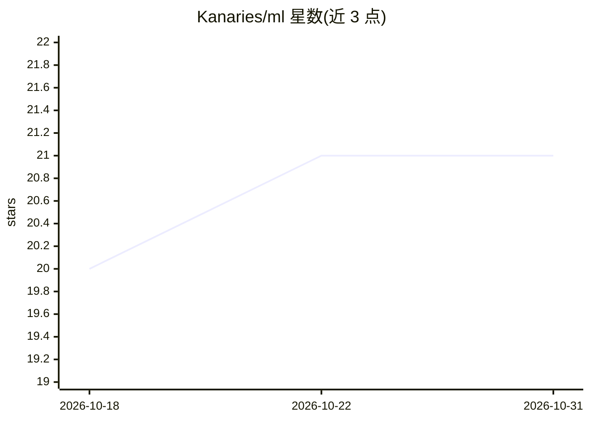

# Kanaries/ml

⭐ 21 · TypeScript · MIT · 推送 2026-10-03 · [GitHub](https://github.com/Kanaries/ml) · [官网](https://ml.kanaries.net/docs) · 组织维护

**JavaScript/TypeScript 的 scikit-learn 风格机器学习库**

面向 JS/TS 开发者的经典机器学习库，提供 50+ 估计器，覆盖分类、回归、聚类、降维、流形学习、异常检测与半监督学习，API 遵循 scikit-learn 的 fit/predict 工作流与命名。可在浏览器、Node.js 与 edge 运行时直接训练和运行模型，无需 Python 后端服务；内置交叉验证与网格搜索（GridSearchCV 等）、文本特征提取（TF-IDF 稀疏矩阵）、评估指标与 asyncMode 的 Web Worker 支持。TypeScript 编写，零运行时依赖，npm 安装。

## 筛选速览

| 维度 | 判定 | 备注 |
|---|---|---|
| AI 角色 | `ai-native` | 本体是模型或模型工具 |
| 许可风险 | `permissive` | MIT |
| 部署形态 | `library` | 以包/库形式分发 |
| 模型依赖 | — | README 未给出锁定关系 |
| 硬件要求 | — | 无带数字的原话,不猜 |
| 安装摩擦 | `low` | 无编译、无系统依赖或容器化 |
| 成熟度 | — | 结构信号不足 |

## 能力要点

- 50+ 估计器覆盖分类/回归/聚类/降维/异常检测/半监督学习
- scikit-learn 风格 API：fit/predict、transformers、metrics
- 浏览器、Node.js、edge 运行时均可运行，无需 Python 后端
- 内置 GridSearchCV/RandomizedSearchCV 等模型选择工具，零运行时依赖

## 适用场景

- 在前端或 Node.js 中直接训练分类/回归/聚类模型，省去 Python 服务
- 把 scikit-learn 工作流迁移到 JS/TS 项目
- 在浏览器中做表格数据的异常检测与客户分群分析

## 场景标签

 · 领域:机器学习/数据科学

## 证据(README 行号)

> L8: **@kanaries/ml** is a machine learning library for JavaScript and TypeScript with a scikit-learn-style API. Train an
> L14: - **50+ estimators** across classification, regression, clustering, dimensionality reduction, manifold learning, an

## 星数曲线

2026-10-18 20 → 2026-10-31 21（+1）

---
*卡片 v1 · prompt 1.4 · 生成 2026-10-28 · 置信度 high · 依据 README sha `8df8f0b6aba2` · [字段定义](../../DATASET.md)*
