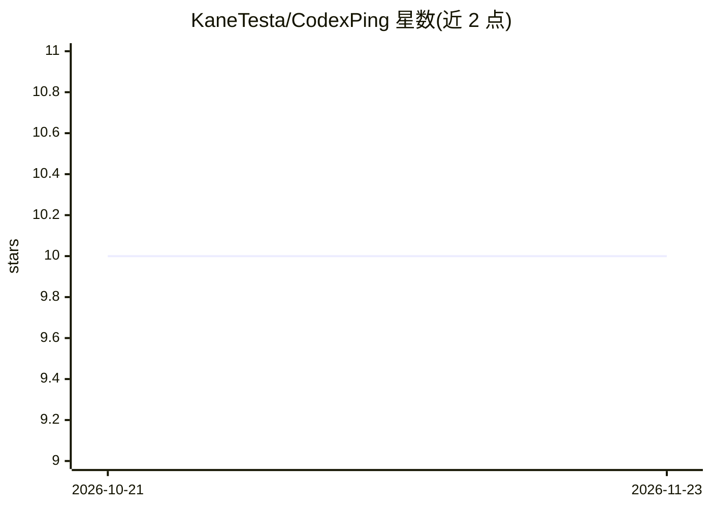

# KaneTesta/CodexPing

⭐ 10 · Swift · MIT · 推送 2026-05-12 · [GitHub](https://github.com/KaneTesta/CodexPing) · 个人维护

**macOS 浮窗状态应用：同步显示 Codex 运行状态提醒**

一个 macOS 状态栏小应用，通过 Codex hooks 监听本地 Codex 会话状态，在跨 Spaces 常驻的悬浮窗上显示 Working/Needs Input/Done/Idle 四种状态，并在 Codex 完成或等待输入时发出提示音。提供一键安装器写入 ~/.codex/hooks.json 配置；要求 macOS、Xcode 与本地已安装 Codex；可下载 .dmg 安装包或用 Xcode 从源码构建运行。

## 筛选速览

| 维度 | 判定 | 备注 |
|---|---|---|
| AI 角色 | `ai-ecosystem` | LLM/agent 周边工具 |
| 许可风险 | `permissive` | MIT |
| 部署形态 | `desktop` | 安装包/桌面程序 |
| 模型依赖 | — | README 未给出锁定关系 |
| 硬件要求 | — | 无带数字的原话,不猜 |
| 安装摩擦 | `low` | 无编译、无系统依赖或容器化 |
| 成熟度 | — | 结构信号不足 |

## 能力要点

- 跨 Spaces 的置顶悬浮窗，自动跟随 Codex 状态更新
- 监听四种状态：Working / Needs Input / Done / Idle
- Codex 完成或等待输入时播放提示音
- 一键安装器配置 Codex hooks（写入 ~/.codex/hooks.json）

## 适用场景

- 在 VS Code 等其他窗口工作时不错过 Codex 的等待输入请求
- 后台运行长任务时及时得知 Codex 完成
- 多桌面环境下持续查看 Codex 会话进度

## 场景标签

 · 领域:开发者工具/效率工具

## 证据(README 行号)

> L9: CodexPing is a small macOS status app that keeps a floating overlay in sync with Codex activity — even when you’re n
> L13: It listens to the status of your Codex chat and shows one of four states:
> L52: When the app launches, it checks whether Codex hooks are set up.

## 星数曲线

2026-10-21 10 → 2026-11-23 10（+0）

---
*卡片 v1 · prompt 1.4 · 生成 2026-11-20 · 置信度 high · 依据 README sha `af09ca09016c` · [字段定义](../../DATASET.md)*
