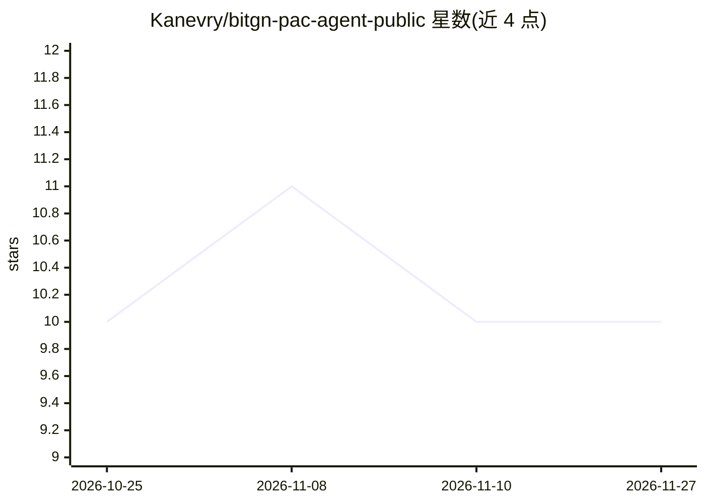

# Kanevry/bitgn-pac-agent-public

⭐ 10 · TypeScript · MIT · 推送 2026-11-01 · [GitHub](https://github.com/Kanevry/bitgn-pac-agent-public) · [官网](https://bitgn.com/challenge/PAC) · 个人维护

**面向 BitGN PAC 2026 基准的防御纵深个人 Agent 参考实现**

BitGN Personal Agent Challenge 2026（Vienna 赛区第一名）的参赛代码，作为研究性参考实现发布，作者声明不再维护、不处理 issue/PR。Agent 运行在沙箱虚拟机内的文件工作区中，通过 ConnectRPC 工具 API 读写文件完成自然语言任务；核心机制是分层加固：路径越界守卫、PII 拒答、destructive 操作刹车、引用校验、供应商密钥遮蔽与提示注入扫描，各层可用环境变量独立开关。基于 Vercel AI SDK 的 generateText 循环与原生工具调用，评分只看可观测副作用。

## 筛选速览

| 维度 | 判定 | 备注 |
|---|---|---|
| AI 角色 | `ai-native` | 本体是模型或模型工具 |
| 许可风险 | `permissive` | MIT |
| 部署形态 | `None` |  |
| 模型依赖 | locked-api |  |
| 硬件要求 | — | 无带数字的原话,不猜 |
| 安装摩擦 | `low` | 无编译、无系统依赖或容器化 |
| 成熟度 | `idea` | |

## 能力要点

- 五层可独立开关的防御层（B1-B5：路径守卫/PII 拒答/引用校验/破坏性刹车/密钥遮蔽）
- Post-read 注入与钓鱼扫描器，检测 16+ 种注入模式（含 base64 变体）
- 三同心环架构，加固环为零依赖纯 TypeScript 模块
- 会话模式与 Playground 模式两种运行方式

## 适用场景

- 研究提示注入攻击下个人 Agent 的防御设计
- 复现 BitGN PAC 基准的参赛方案
- 借鉴文件操作 Agent 的工具调用与结果上报协议
- 以独立模块形式复用加固层代码

## 场景标签

 · 领域:AI Agent/安全加固

## 证据(README 行号)

> L9: An autonomous AI agent built for the **BitGN Personal Agent Challenge (PAC)** — a deterministic, side-effect-scored 
> L15: The agent operates inside a sandboxed virtual machine (a file-based personal-knowledge workspace resembling an Obsi
> L123: |**B5**|`redaction.ts`|Post-read|Scan tool results for high-precision vendor secret shapes (AWS, GitHub, Anthropic

## 星数曲线

2026-10-25 10 → 2026-11-27 10（+0）

---
*卡片 v1 · prompt 1.4 · 生成 2026-11-20 · 置信度 high · 依据 README sha `442681afece5` · [字段定义](../../DATASET.md)*
