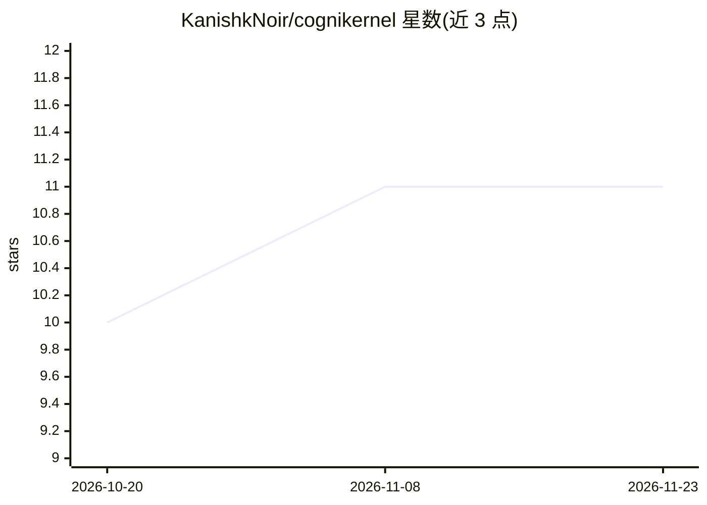

# KanishkNoir/cognikernel

⭐ 11 · Python · Apache-2.0 · 推送 2026-10-18 · [GitHub](https://github.com/KanishkNoir/cognikernel) · [官网](https://github.com/KanishkNoir/cognikernel/releases) · 个人维护

**为 Claude Code/Codex 提供跨会话持久项目记忆的开发工具**

面向 AI 编码 agent 的项目记忆层：通过四个 hook 挂钩点（SessionStart/UserPromptSubmit/PreToolUse/Stop）观察编码会话，用两个微调编码器模型（SetFit 显著性分类器与跨编码器 supersession 判别器，本地 ONNX/CPU 毫秒级）将决策、约束与被放弃方案提取为事件溯源存储，并在下次会话注入紧凑记忆块；MCP server 提供 recall/find_related/skeleton/get_session_state 四个工具。存储按项目路径键控，Claude Code 与 Codex 共享同一记忆。无 API key、无云端调用，全部本地运行；未安装模型权重时回退到词法路径（fail-open）。当前更新暂停，停在 v0.1.3。

## 筛选速览

| 维度 | 判定 | 备注 |
|---|---|---|
| AI 角色 | `ai-ecosystem` | LLM/agent 周边工具 |
| 许可风险 | `permissive` | Apache-2.0 |
| 部署形态 | `library` | 以包/库形式分发 |
| 模型依赖 | — | README 未给出锁定关系 |
| 硬件要求 | — | 无带数字的原话,不猜 |
| 安装摩擦 | `low` | 无编译、无系统依赖或容器化 |
| 成熟度 | `idea` | |

## 能力要点

- 事件溯源记忆存储，按项目路径键控，Claude Code 与 Codex 跨工具共享
- 两个本地微调编码器模型做显著性分类与决策取代判定，无 LLM/API 调用
- 四个 hook 挂钩点实现注入、召回、行动前守卫与自动捕获
- MCP 工具 recall/find_related/skeleton/get_session_state 与 init/doctor/why 等 CLI

## 适用场景

- 让编码 agent 在新会话直接接续上次会话的决策与约束
- 避免每次会话重新推导架构或重复回答已解决的问题
- 在准备违反既往决策的动作发生时即时提示

## 场景标签

`Agent 记忆` · 领域:Agent 开发

## 证据(README 行号)

> L10: # CogniKernel: persistent, structured project memory for Claude Code and Codex
> L107: CogniKernel watches a coding session through its hook surfaces, extracts the
> L135: - **MCP tools** for targeted use: `recall` · `find_related` · `skeleton` ·

## 星数曲线

2026-10-20 10 → 2026-11-23 11（+1）

---
*卡片 v1 · prompt 1.4 · 生成 2026-11-19 · 置信度 high · 依据 README sha `ec6872732ff8` · [字段定义](../../DATASET.md)*
