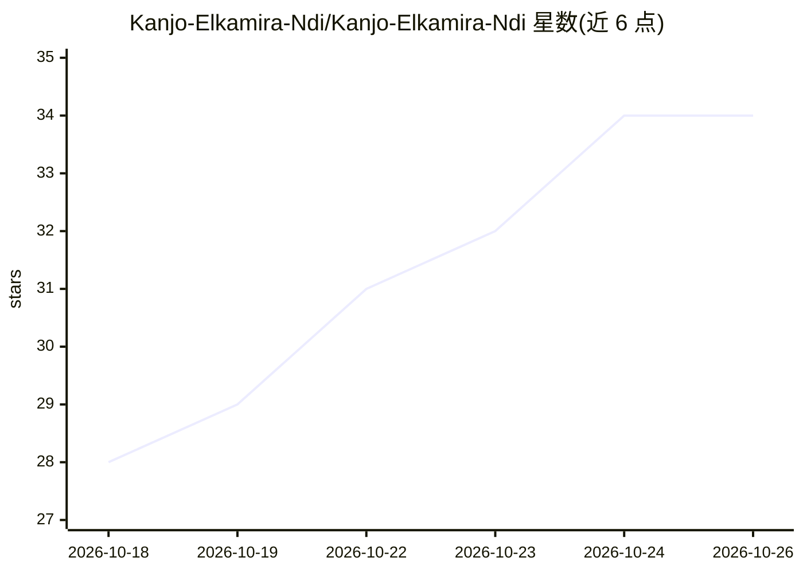

# Kanjo-Elkamira-Ndi/Kanjo-Elkamira-Ndi

⭐ 34 · TypeScript · 推送 2026-09-26 · [GitHub](https://github.com/Kanjo-Elkamira-Ndi/Kanjo-Elkamira-Ndi) · [官网](https://kanjo-elkamira-ndi.vercel.app) · 个人维护

**个人开发者简介页：列出全栈与 AI 项目经历**

这是 Kanjo Elkamira Ndi 的 GitHub 个人主页 README，非可安装软件。内容为自我介绍（2 年全栈开发经验）、技术栈清单（PERN/Laravel/Flutter/Python 等）、以及项目列表：Laravel 实习管理系统、学校管理系统、开发中的 AI 社交陪伴平台 Revive、Python 神经网络交通流量预测、HDBSCAN 人脸识别、Wikimedia 发音链接系统等，并附联系方式。不含安装方式、运行机制或代码入口。

## 筛选速览

| 维度 | 判定 | 备注 |
|---|---|---|
| AI 角色 | `ai-knowledge` | 知识聚合/清单类 |
| 许可风险 | `none` | — |
| 部署形态 | `None` |  |
| 模型依赖 | — | README 未给出锁定关系 |
| 硬件要求 | — | 无带数字的原话,不猜 |
| 安装摩擦 | `low` | 无编译、无系统依赖或容器化 |
| 成熟度 | — | 结构信号不足 |

## 能力要点

- 列出实习管理、学校管理、食品配送等全栈项目
- AI 项目包括交通流量预测（神经网络）与人脸识别（HDBSCAN）
- 开发中项目 Revive：AI 社交陪伴平台，支持双向消息与通话

## 适用场景

- 了解该开发者的技能栈与项目经历
- 通过 LinkedIn/GitHub/Email 联系协作

## 场景标签

 · 领域:个人主页/作品集

## 证据(README 行号)

> L1: # 👋 Hi, I'm Kanjo Elkamira Ndi
> L84: ### DigiMark Internship Management System (DIMS)
> L111: ### AI Traffic Flow Prediction System

## 星数曲线

2026-10-18 28 → 2026-10-26 34（+6）

---
*卡片 v1 · prompt 1.4 · 生成 2026-10-25 · 置信度 mid · 依据 README sha `303bee9acb03` · [字段定义](../../DATASET.md)*
