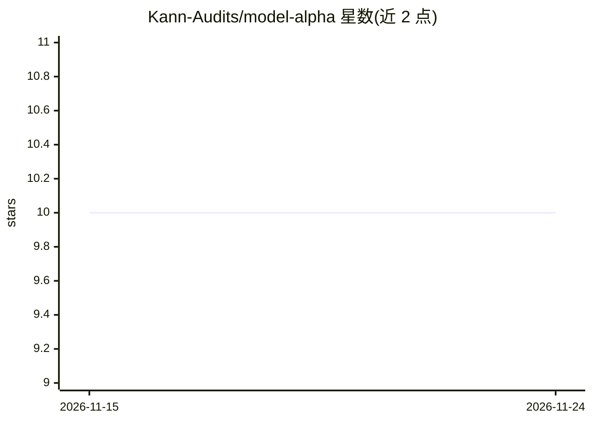

# Kann-Audits/model-alpha

⭐ 10 · JavaScript · MIT · 推送 2026-08-24 · [GitHub](https://github.com/Kann-Audits/model-alpha) · 个人维护

**以 agent skill 形式安装的 Solidity 合约漏洞审计工具**

该仓库打包为一个 AI agent 技能：包含基于 @solidity-parser/parser 的 JavaScript 调用图提取器和一个 Python CLI。安装到 agent 的 skills 目录后，用户用自然语言要求审计 .sol 文件，CLI 提取每个函数的调用图并 POST 到托管的 Model Alpha 端点，逐函数返回 VULNERABLE/SAFE 判定，含 429 限流等待重试与错误输出。依赖一次性 npm install；模型权重另以 gated release 形式发布在 Hugging Face。

## 筛选速览

| 维度 | 判定 | 备注 |
|---|---|---|
| AI 角色 | `ai-native` | 本体是模型或模型工具 |
| 许可风险 | `permissive` | MIT |
| 部署形态 | `library` | 以包/库形式分发 |
| 模型依赖 | — | README 未给出锁定关系 |
| 硬件要求 | — | 无带数字的原话,不猜 |
| 安装摩擦 | `low` | 无编译、无系统依赖或容器化 |
| 成熟度 | — | 结构信号不足 |

## 能力要点

- 逐函数提取调用图并发送到托管端点，返回 VULNERABLE/SAFE 判定
- 为 opencode/Claude/Codex/Hermes 四种 agent 提供一键安装路径
- 429 限流自动等待 61 秒重试，可用 --rate-limit-wait 覆盖
- 模型权重（AWQ int4，约 5.7 GB）以 gated release 形式提供

## 适用场景

- 让编码 agent 审计 Solidity 合约中的漏洞
- 检查单个 .sol 文件是否包含不安全函数
- 批量审计合约时自动处理限流与错误输出

## 场景标签

`网络安全` `代码审查` · 领域:编码与开发

## 证据(README 行号)

> L3: Audit Solidity contracts for vulnerabilities using AI. Install it as a skill, then ask your agent to audit any contr
> L30: Ask your agent, e.g. *"audit this contract"* or *"is this Solidity safe?"* pointing at a `.sol` file. It extracts e

## 星数曲线

2026-11-15 10 → 2026-11-24 10（+0）

---
*卡片 v1 · prompt 1.4 · 生成 2026-11-20 · 置信度 mid · 依据 README sha `5a391cd59dee` · [字段定义](../../DATASET.md)*
