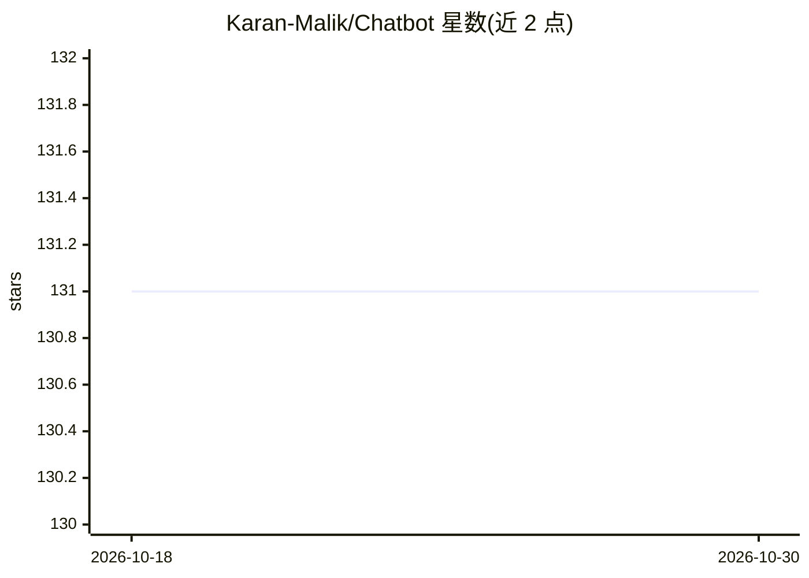

# Karan-Malik/Chatbot

⭐ 131 · Python · MIT · 推送 2026-05-08 · [GitHub](https://github.com/Karan-Malik/Chatbot) · [官网](https://ted-the-deep-learning-bot.herokuapp.com/) · 个人维护

**Python 实现的深度学习多用途聊天机器人（Ted）**

Ted 是用 Python3 编写的多用途聊天机器人，通过 NLP 与深度学习分析用户消息，将其分类到更宽泛的类别后回复合适消息或所需信息。后端以 Flask 托管，并部署于 Heroku。本地运行方式为：git clone 仓库、按 requirements.txt 用 pip 安装依赖库、设置 FLASK_APP 后以 flask run 启动，再在浏览器打开相应 URL 即可对话。

## 筛选速览

| 维度 | 判定 | 备注 |
|---|---|---|
| AI 角色 | `ai-native` | 本体是模型或模型工具 |
| 许可风险 | `permissive` | MIT |
| 部署形态 | `library` | 以包/库形式分发 |
| 模型依赖 | — | README 未给出锁定关系 |
| 硬件要求 | — | 无带数字的原话,不猜 |
| 安装摩擦 | `low` | 无编译、无系统依赖或容器化 |
| 成熟度 | — | 结构信号不足 |

## 能力要点

- NLP + 深度学习对用户消息做意图分类后生成回复
- Flask Web 界面托管
- 支持 Heroku 部署

## 适用场景

- 我想部署一个可对话并协助日常任务的小型聊天机器人
- 我想在本地学习/运行一个 Flask + 深度学习聊天机器人示例

## 场景标签

`聊天机器人` · 领域:对话与助手

## 证据(README 行号)

> L4: Ted is a multipurpose chatbot made using Python3, who can chat with you and help in performing daily tasks. It uses 

## 星数曲线

2026-10-18 131 → 2026-10-30 131（+0）

---
*卡片 v1 · prompt 1.4 · 生成 2026-10-22 · 置信度 mid · 依据 README sha `c6b42f0294a4` · [字段定义](../../DATASET.md)*
