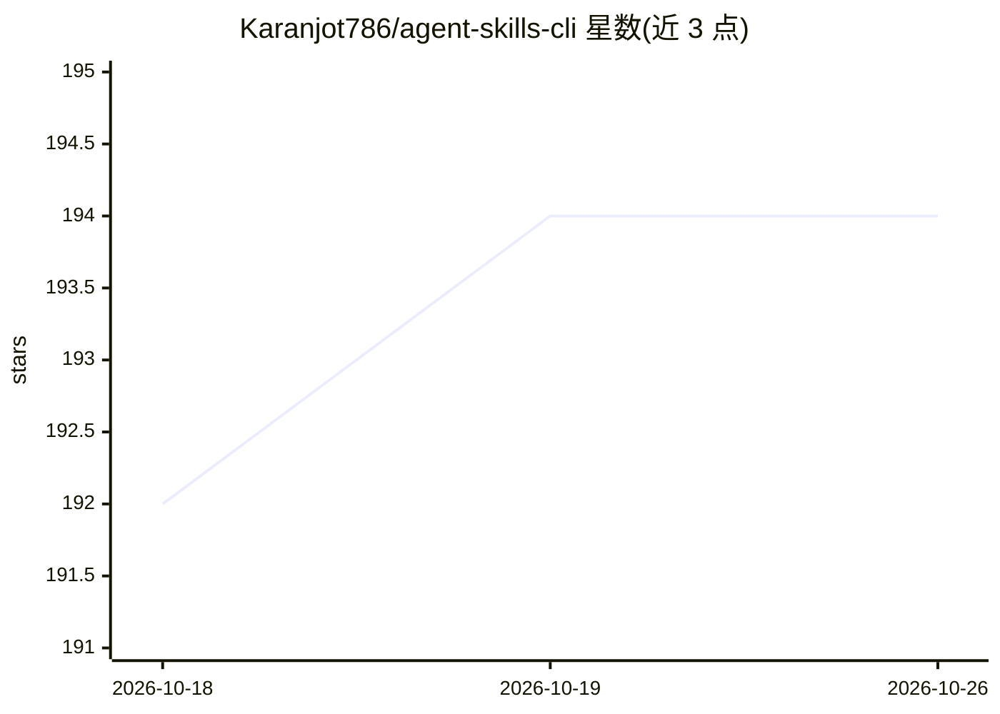

# Karanjot786/agent-skills-cli

⭐ 194 · TypeScript · MIT · 推送 2026-10-11 · [GitHub](https://github.com/Karanjot786/agent-skills-cli) · [官网](https://www.npmjs.com/package/agent-skills-cli) · 个人维护

**跨 45 个编码 agent 统一安装管理 AI 技能的 CLI 工具**

面向使用编码 agent 的开发者的命令行工具 `skills`：从 agentskills.in 市场（索引逾 22.2 万个技能）、GitHub、私有 Git 仓库与 npm 包安装技能，写入用户选择的 45 个 agent（Claude Code、Cursor、GitHub Copilot 等）的技能目录。提供安装前安全扫描、质量评分、token 预算选取、lockfile 冻结安装与 CI 审计命令。技能以含 SKILL.md 的文件夹定义；需 Node.js 18+，npm 全局安装。匿名遥测可关闭。

## 筛选速览

| 维度 | 判定 | 备注 |
|---|---|---|
| AI 角色 | `ai-ecosystem` | LLM/agent 周边工具 |
| 许可风险 | `permissive` | MIT |
| 部署形态 | `library` | 以包/库形式分发 |
| 模型依赖 | — | README 未给出锁定关系 |
| 硬件要求 | — | 无带数字的原话,不猜 |
| 安装摩擦 | `low` | 无编译、无系统依赖或容器化 |
| 成熟度 | — | 结构信号不足 |

## 能力要点

- 支持 45 个编码 agent，一次安装可写入全部（--all）
- 技能安装前进行安全扫描，高危发现阻止安装、可 CI 审计
- token 预算命令按上下文限额选取技能（skills budget）
- 市场索引 222,000+ 技能，来源含市场/GitHub/私有 Git/npm

## 适用场景

- 在多个编码 agent 间统一安装和更新技能
- 团队通过 .skillsrc 与 lockfile 统一技能版本
- 对已安装技能做安全审计与质量评分
- 按上下文预算挑选技能控制 token 成本

## 场景标签

`提示工程` · 领域:Agent 开发

## 证据(README 行号)

> L3: Install, update and manage AI agent skills across 45 coding agents from one command line.
> L11: `skills` finds skills in the agentskills.in marketplace, in GitHub and private Git repositories, and in npm package
> L18: - **45 agents.** One install can write to every agent you select, or to all of them with `--all`.

## 星数曲线

2026-10-18 192 → 2026-10-26 194（+2）

---
*卡片 v1 · prompt 1.4 · 生成 2026-10-22 · 置信度 high · 依据 README sha `d9492d6887f2` · [字段定义](../../DATASET.md)*
