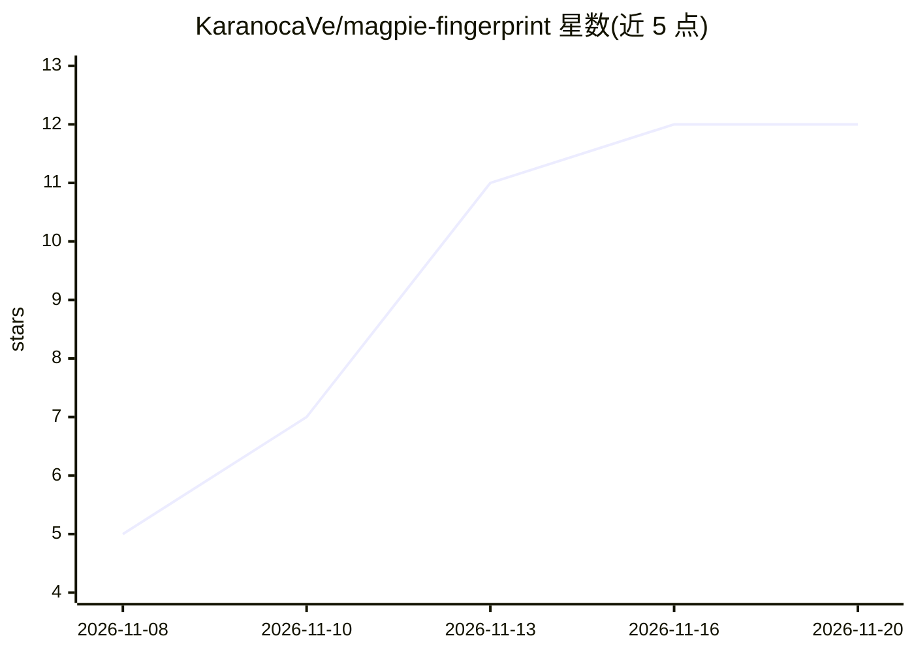

# KaranocaVe/magpie-fingerprint

⭐ 12 · TypeScript · MIT · 推送 2026-11-17 · [GitHub](https://github.com/KaranocaVe/magpie-fingerprint) · 个人维护 · 中文 README

**Magpie 内的模型指纹诊断插件：排查疑似模型替换**

作为 Magpie 插件运行，复用其已配置的模型、认证与网关，对同一批最多 24 个模型发送三条数值指纹挑战，用内置 lmfpd-sdk 检测器对参考库中邻近模型排名，用于在服务变更后重跑对比、排查疑似模型替换。支持自定义请求头预设、实时采样计数、取消任务、查看实际响应路由，原始回复与数据版本存于本地历史并可导出 JSON。README 明确说明排名仅是调查证据，不构成模型身份证明。

## 筛选速览

| 维度 | 判定 | 备注 |
|---|---|---|
| AI 角色 | `ai-ecosystem` | LLM/agent 周边工具 |
| 许可风险 | `permissive` | MIT |
| 部署形态 | `None` |  |
| 模型依赖 | — | README 未给出锁定关系 |
| 硬件要求 | — | 无带数字的原话,不猜 |
| 安装摩擦 | `low` | 无编译、无系统依赖或容器化 |
| 成熟度 | — | 结构信号不足 |

## 能力要点

- 复用 Magpie 配置的模型与网关，单批最多 24 个模型、每个 3 条挑战
- 提供 Codex CLI/Claude Code/OpenCode/Cline/Roo Code 可编辑请求头预设
- 排名由固定版本的 lmfpd-sdk 检测器生成，支持取消与实时采样计数
- 本地历史保留原始回复与数据版本，可导出/复制 JSON

## 适用场景

- 服务方更换通道后重跑指纹对比，排查疑似模型替换
- 跨多个提供商对比同一批模型的数值响应指纹
- 通过 --demo 固定数据隔离地演示检测流程

## 场景标签

`模型评测` · 领域:评测与运维

## 证据(README 行号)

> L5: Investigate suspected model substitution directly in Magpie. Compare numeric
> L8: `lmfpd-sdk` detector ranks nearby reference-bank models. Rankings are evidence
> L30: magpie plugin add github:KaranocaVe/magpie-fingerprint

## 星数曲线

2026-11-08 5 → 2026-11-20 12（+7）

---
*卡片 v1 · prompt 1.4 · 生成 2026-11-18 · 置信度 high · 依据 README sha `adc0a90f64dc` · [字段定义](../../DATASET.md)*
