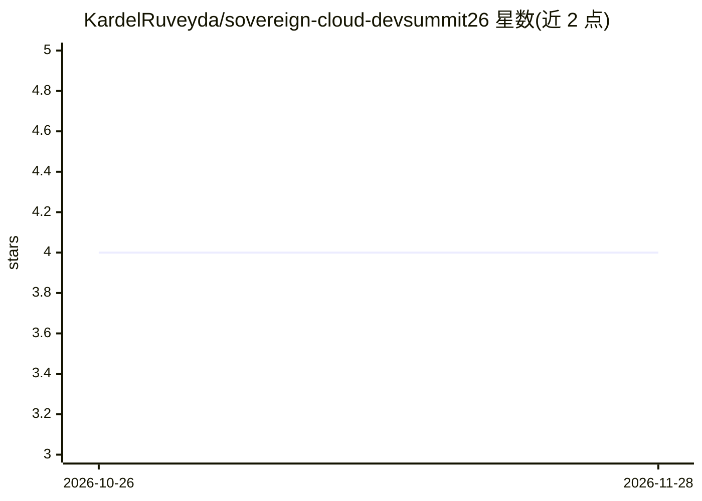

# KardelRuveyda/sovereign-cloud-devsummit26

⭐ 4 · HTML · MIT · 推送 2026-10-18 · [GitHub](https://github.com/KardelRuveyda/sovereign-cloud-devsummit26) · 个人维护

**数据不出本机的 RAG 助手教学演示：三种模型后端一键切换**

一个 .NET 知识助手示例，从合成公司文档回答问题，可在云 mock、Foundry Local 本机模型、Azure Local 上的 Foundry Local（OpenAI 兼容端点）三种后端间通过改一行代码切换。配套浏览器实验室走完八步流程：出口流量监视器展示云模式下随请求外发的敏感内容，切换本机模型后用零请求证明数据未离开设备，含 13 题四模型对比报告。检索用 IDF 关键词打分而非嵌入。仅支持 Windows x64。

## 筛选速览

| 维度 | 判定 | 备注 |
|---|---|---|
| AI 角色 | `ai-native` | 本体是模型或模型工具 |
| 许可风险 | `permissive` | MIT |
| 部署形态 | `desktop` | 安装包/桌面程序 |
| 模型依赖 | — | README 未给出锁定关系 |
| 硬件要求 | — | 无带数字的原话,不猜 |
| 安装摩擦 | `medium` | 含编译或系统依赖之一 |
| 成熟度 | `idea` | |

## 能力要点

- 三种后端共用 Microsoft.Extensions.AI 的 IChatClient 接口，一行代码切换
- Egress Traffic Monitor 完整打印出站请求并高亮敏感项
- 13 题测试集（10 可答 + 3 陷阱）对比四个小型模型
- 断网仍可回答，本机模型默认 phi-3.5-mini

## 适用场景

- 演示 RAG 请求会把哪些敏感数据发往外部模型
- 评估小型模型在本机/NPU 上的加载与回答表现
- 教学场景中讲解数据主权与本地推理路线

## 场景标签

`RAG` `文档问答` `教程课程` · 领域:知识与检索

## 证据(README 行号)

> L5: Leak Hunt is a small .NET knowledge assistant that answers questions from a few (synthetic) company documents. The s
> L43: The three backends sit behind the same `IChatClient` interface from `Microsoft.Extensions.AI`, so the application c
> L73: - Windows 10/11 x64 (the app targets `net10.0-windows10.0.19041.0` because it uses the Windows build of the Foundry

## 星数曲线

2026-10-26 4 → 2026-11-28 4（+0）

---
*卡片 v1 · prompt 1.4 · 生成 2026-11-21 · 置信度 high · 依据 README sha `cc84aa935790` · [字段定义](../../DATASET.md)*
