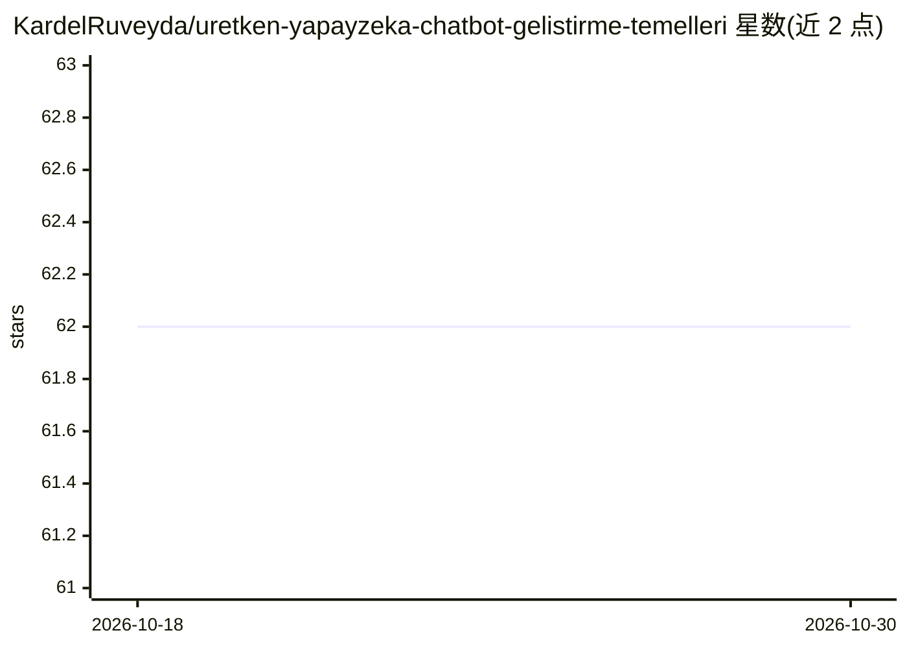

# KardelRuveyda/uretken-yapayzeka-chatbot-gelistirme-temelleri

⭐ 62 · 推送 2025-12-23 · [GitHub](https://github.com/KardelRuveyda/uretken-yapayzeka-chatbot-gelistirme-temelleri) · [官网](https://kardelruveyda.github.io/uretken-yapayzeka-chatbot-gelistirme-temelleri) · 组织维护

**面向大学生的生成式 AI 聊天机器人开发课程讲义仓库**

Marmara 大学与 Yıldız Technical 大学课程『生成式 AI 辅助聊天机器人开发基础』的笔记分享仓库。README 说明课程目标：学习生成式 AI 与聊天机器人基础概念、认识现代聊天bot开发工具与平台、理解自然语言处理与对话管理原则、获得面向真实场景的聊天机器人开发实践。仓库主题标签涉及 LangChain、LangGraph、OpenAI、LLM。README 主体为 40 余名贡献者列表，未展示具体课程内容结构、安装或运行方式。

## 筛选速览

| 维度 | 判定 | 备注 |
|---|---|---|
| AI 角色 | `ai-knowledge` | 知识聚合/清单类 |
| 许可风险 | `none` | — |
| 部署形态 | `None` |  |
| 模型依赖 | — | README 未给出锁定关系 |
| 硬件要求 | — | 无带数字的原话,不猜 |
| 安装摩擦 | `low` | 无编译、无系统依赖或容器化 |
| 成熟度 | — | 结构信号不足 |

## 能力要点

- 两所土耳其大学开设的生成式 AI 聊天机器人课程
- 课程覆盖 NLP、对话管理与真实场景 chatbot 开发实践
- 主题标签包含 LangChain / LangGraph / OpenAI / LLM

## 适用场景

- 作为学生学习聊天机器人开发的课程资料
- 查看生成式 AI chatbot 开发基础的教学大纲与讲义

## 场景标签

`教程课程` · 领域:学习与行业

## 证据(README 行号)

> L1: ## Üretken Yapay Zeka Yardımı ile Chatbot Geliştirme Temelleri
> L3: Bu ders, öğrencilerin üretken yapay zeka teknolojilerini kullanarak chatbot geliştirme süreçlerini derinlemesine kav

## 星数曲线

2026-10-18 62 → 2026-10-30 62（+0）

---
*卡片 v1 · prompt 1.4 · 生成 2026-10-24 · 置信度 mid · 依据 README sha `10d1381b0f9d` · [字段定义](../../DATASET.md)*
