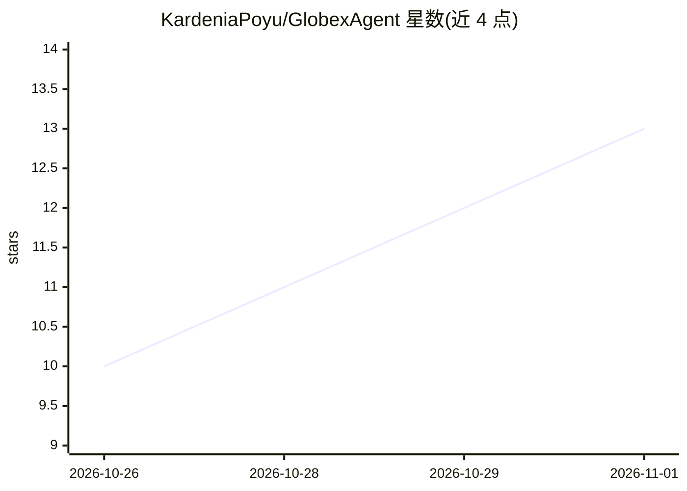

# KardeniaPoyu/GlobexAgent

⭐ 13 · Python · 推送 2026-08-30 · [GitHub](https://github.com/KardeniaPoyu/GlobexAgent) · 个人维护 · 中文 README

**基于 AgentScope 2.0 的跨境电商多 Agent 对话购物系统**

面向跨境电商场景的 Agent 应用：MainAgent 统一调度并可直接调用业务工具，按并行/上下文隔离/链深条件派发 SearchAgent 与 TradeAgent 子 Agent。检索采用 embedding+rerank 二阶段召回（Qdrant），失败逐级降级；含语义缓存、网关并发限流、Redis Stream 异步队列、长期偏好记忆与品类洞察 RAG。后端 FastAPI + WebSocket，前端 React 18，提供 Docker Compose 与 uv 两种启动方式，附 137 个单测与评测回归脚本。

## 筛选速览

| 维度 | 判定 | 备注 |
|---|---|---|
| AI 角色 | `ai-native` | 本体是模型或模型工具 |
| 许可风险 | `none` | — |
| 部署形态 | `self-host` | docker 或自建部署 |
| 模型依赖 | — | README 未给出锁定关系 |
| 硬件要求 | — | 无带数字的原话,不猜 |
| 安装摩擦 | `low` | 无编译、无系统依赖或容器化 |
| 成熟度 | — | 结构信号不足 |

## 能力要点

- MainAgent 单干优先 + 条件派发子 Agent 的多 Agent 编排
- embedding+rerank 二阶段召回，降级链 embedding_only → keyword_2gram
- 语义缓存（余弦≥0.95 复用回复）与 GatewayThrottle 并发限流
- 长期偏好记忆跨会话、跨重启生效

## 适用场景

- 用自然语言完成跨境商品搜索与下单/取消订单
- 搭建带品类洞察 RAG 与到手价内联的购物咨询系统
- 作为 AgentScope 2.0 多 Agent 落地工程参考（DDD 洋葱架构）

## 场景标签

`多智能体` `RAG` `聊天机器人` · 领域:Agent 开发

## 证据(README 行号)

> L3: 基于 AgentScope 2.0 的跨境电商超级搜索框 Agent 系统，DDD 洋葱架构落地：
> L8: - **SearchAgent**（CatalogSearchAgent）：商品检索专家，query 改写 → **embedding+rerank 二阶段召回**（Qdrant），

## 星数曲线

2026-10-26 10 → 2026-11-01 13（+3）

---
*卡片 v1 · prompt 1.4 · 生成 2026-10-31 · 置信度 high · 依据 README sha `be6f70c0201a` · [字段定义](../../DATASET.md)*
