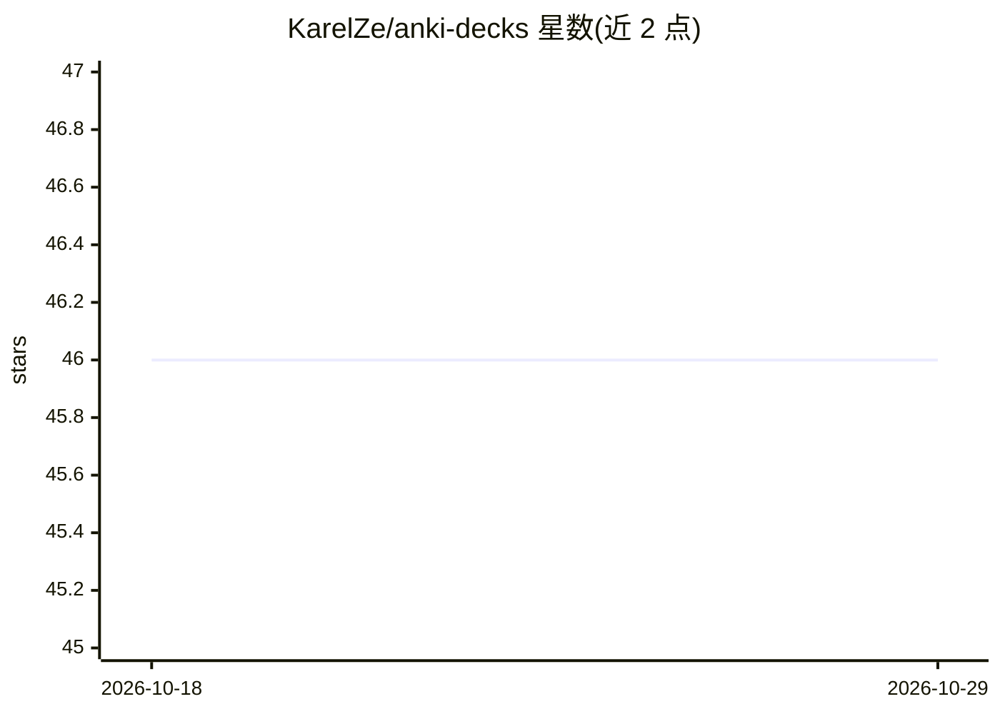

# KarelZe/anki-decks

⭐ 46 · 推送 2026-10-22 · [GitHub](https://github.com/KarelZe/anki-decks) · 个人维护

**卡尔斯鲁厄理工学院课程 Anki 闪卡牌组合集**

由维护者整理的 Anki 闪卡牌组集合，覆盖卡尔斯鲁厄理工学院（KIT）约 23 门课程，含机器学习、深度学习、线性代数、法学与商业课程等，标注授课教师、学期与语言（英语/德语），部分牌组标注进行中或先修依赖。牌组以 markdown 文件维护并自动构建为 Anki release，通过 `ki` 工具协作编辑；部分含公式的卡片需 LaTeX 支持渲染。README 声明牌组可能含错误、不完整或过时。

## 筛选速览

| 维度 | 判定 | 备注 |
|---|---|---|
| AI 角色 | `ai-knowledge` | 知识聚合/清单类 |
| 许可风险 | `none` | — |
| 部署形态 | `None` |  |
| 模型依赖 | — | README 未给出锁定关系 |
| 硬件要求 | — | 无带数字的原话,不猜 |
| 安装摩擦 | `low` | 无编译、无系统依赖或容器化 |
| 成熟度 | — | 结构信号不足 |

## 能力要点

- 约 23 门 KIT 课程的 Anki 闪卡牌组，含课程、教师、学期与语言信息
- 以 markdown 协作编辑，release 自动重新构建
- 使用 `ki` 工具协作管理牌组内容
- 部分牌组标注先修依赖与进行中状态

## 适用场景

- KIT 学生复习机器学习、深度学习、线性代数等课程
- 直接下载现成 Anki 牌组开始记忆复习
- 通过 markdown 或 `ki` 工具补充、修正牌组内容

## 场景标签

 · 领域:教育/学习资料

## 证据(README 行号)

> L1: This is a collection of flashcard decks created for classes at Karlsruher Institute of Technology.
> L11: |Deep Learning for Computer Vision|Prof. Dr. R. Stiefelhagen|SS 22|:us:|WIP :construction:|Download 📥|

## 星数曲线

2026-10-18 46 → 2026-10-29 46（+0）

---
*卡片 v1 · prompt 1.4 · 生成 2026-10-25 · 置信度 high · 依据 README sha `1545915e48f6` · [字段定义](../../DATASET.md)*
