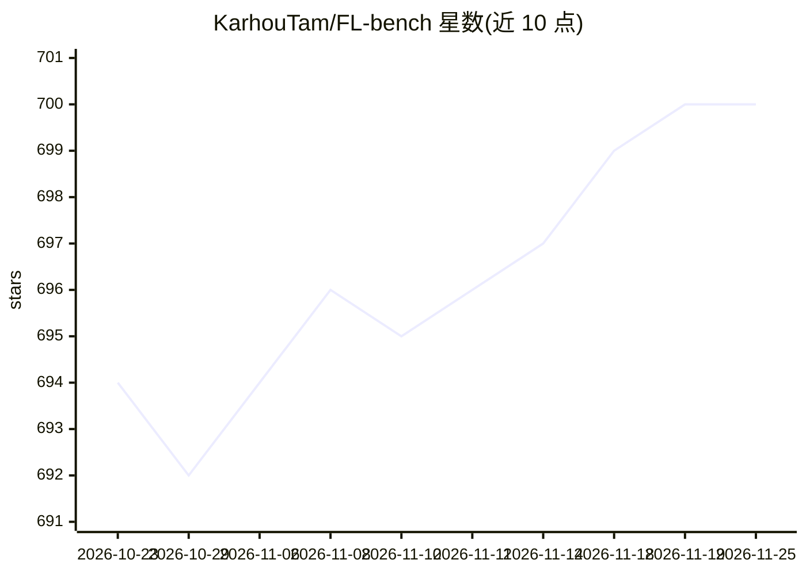

# KarhouTam/FL-bench

⭐ 700 · Python · GPL-3.0 · 推送 2026-11-06 · [GitHub](https://github.com/KarhouTam/FL-bench) · 个人维护 · 中文 README

**联邦学习方法的科研基准测试框架**

基于 PyTorch 的联邦学习基准项目，收录并实现了约 60 篇论文中的 FL 方法，分为传统 FL、个性化 FL、领域泛化与差分隐私四类；提供数据划分生成脚本、命令行实验入口与 YAML 配置体系，支持 visdom/tensorboard 监控与通过 Ray 进行并行训练。所有方法类继承自 FedAvgServer/FedAvgClient，可按文档指引继承实现新方法。安装通过 pip 安装 requirements 完成。

## 筛选速览

| 维度 | 判定 | 备注 |
|---|---|---|
| AI 角色 | `ai-native` | 本体是模型或模型工具 |
| 许可风险 | `viral` | GPL-3.0 |
| 部署形态 | `library` | 以包/库形式分发 |
| 模型依赖 | — | README 未给出锁定关系 |
| 硬件要求 | — | 无带数字的原话,不猜 |
| 安装摩擦 | `low` | 无编译、无系统依赖或容器化 |
| 成熟度 | — | 结构信号不足 |

## 能力要点

- 收录约 60 种联邦学习方法实现，含传统、个性化、领域泛化与差分隐私四类
- 通过 Ray 支持并行模式加速实验，也可手动创建 Ray 集群
- 内置 Torchvision 常用模型族与 16 个数据集的多策略划分
- CLI、YAML 配置与代码内默认值三级参数优先级体系

## 适用场景

- 为新的联邦学习算法跑标准对比实验
- 在 Dir、合成划分等策略下生成非 IID 客户端数据
- 复现论文中的个性化联邦学习基线

## 场景标签

`科研工具` · 领域:学习与行业

## 证据(README 行号)

> L3: Benchmarking Federated Learning Methods.
> L85: ALL classes of methods are inherited from `FedAvgServer` and `FedAvgClient`. If you wanna figure out the entire wor
> L171: ## Parallel Training via `Ray` 🚀

## 星数曲线

2026-10-23 694 → 2026-11-25 700（+6）

---
*卡片 v1 · prompt 1.4 · 生成 2026-11-24 · 置信度 mid · 依据 README sha `b456a9b22d43` · [字段定义](../../DATASET.md)*
