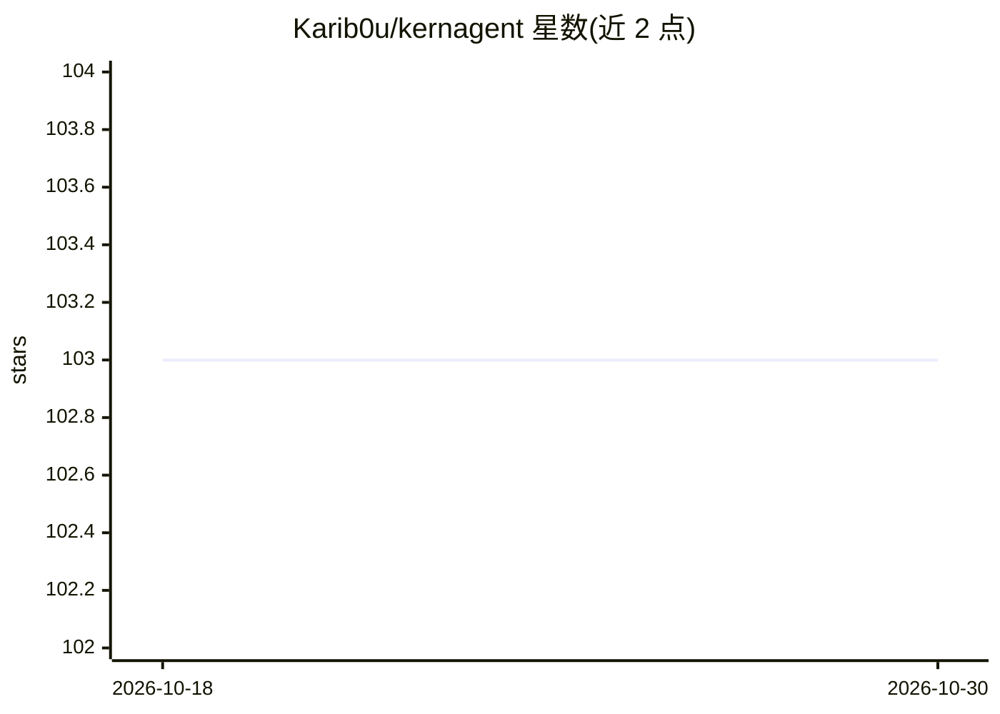

# Karib0u/kernagent

⭐ 103 · Python · Apache-2.0 · 推送 2025-12-09 · [GitHub](https://github.com/Karib0u/kernagent) · 个人维护

**给安全分析师的无头逆向分析 Agent：二进制转可审计快照并问答**

将二进制文件经 Ghidra/PyGhidra 抽取为静态快照（函数、导入、字符串、CAPA 能力提示），再由有界 Agent 通过只读工具（搜索、调用图、反编译片段、xref 解析）基于快照回答问题，答案引用具体地址与工件。提供 summary/ask/oneshot 三类命令，oneshot 输出 MALICIOUS/GRAYWARE/BENIGN/UNKNOWN 分类的确定性分诊报告，可输出 JSON 供 CI 使用。兼容任意 /v1/chat/completions 端点，支持 Ollama/LM Studio 全离线运行。以 Docker 镜像与 shell 包装脚本方式分发。

## 筛选速览

| 维度 | 判定 | 备注 |
|---|---|---|
| AI 角色 | `ai-native` | 本体是模型或模型工具 |
| 许可风险 | `permissive` | Apache-2.0 |
| 部署形态 | `desktop` | 安装包/桌面程序 |
| 模型依赖 | local-ok | 支持本地模型 |
| 硬件要求 | — | 无带数字的原话,不猜 |
| 安装摩擦 | `low` | 无编译、无系统依赖或容器化 |
| 成熟度 | — | 结构信号不足 |

## 能力要点

- 二进制→可移植静态快照，同一二进制产出确定性可复现的报告
- oneshot 分诊报告输出 MALICIOUS/GRAYWARE/BENIGN/UNKNOWN 分类，含 --json 自动化输出
- 答案强制引用函数、xref、导入、字符串与反编译片段等证据
- 兼容任意 /v1/chat/completions 端点，可经 Ollama/LM Studio 全离线运行

## 适用场景

- 在 CI 或批量场景对二进制做自动化恶意性分诊
- 向二进制提问（如 C2 逻辑）并获取带地址证据的回答
- 气隙环境下用本地模型离线分析恶意样本

## 场景标签

`网络安全` · 领域:学习与行业

## 证据(README 行号)

> L19: `kernagent` converts a binary into a **portable static snapshot** and lets an LLM (or your scripts) answer question
> L28: * **Evidence over vibes** — every answer cites functions, xrefs, imports, strings, and **decompilation snippets**
> L222: Deterministic triage report for CI/bulk analysis. Classification:

## 星数曲线

2026-10-18 103 → 2026-10-30 103（+0）

---
*卡片 v1 · prompt 1.4 · 生成 2026-10-23 · 置信度 high · 依据 README sha `87f0d17b501f` · [字段定义](../../DATASET.md)*
