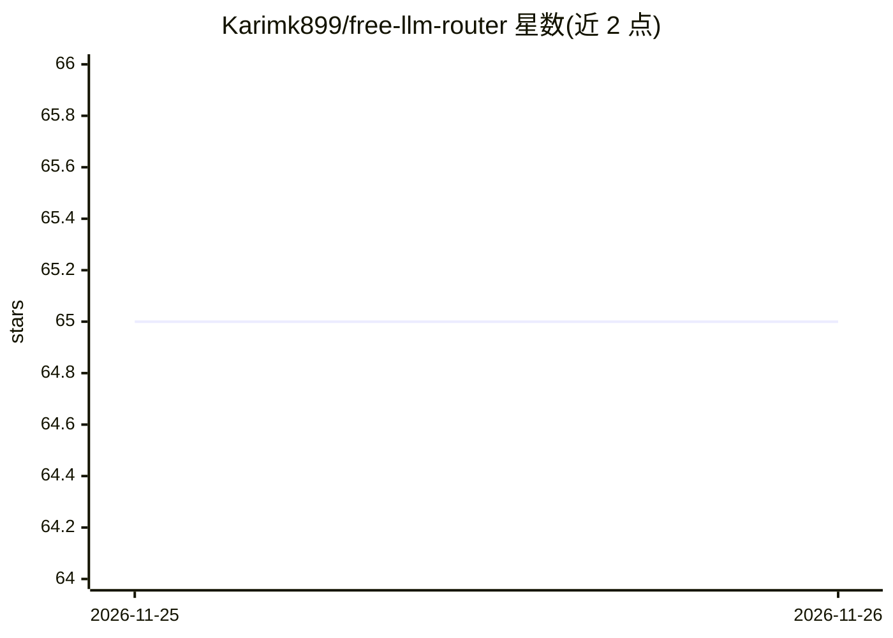

# Karimk899/free-llm-router

⭐ 65 · C++ · MIT · 推送 2026-11-24 · [GitHub](https://github.com/Karimk899/free-llm-router) · [官网](https://github.com/Karimk899/free-llm-router/releases) · 个人维护

**免费额度 LLM 路由器：将请求分配到免费提供商并自动回退**

FreeLlmRouter 以 OpenAI 兼容的 CLI/路由器形式运行，将请求路由到免费额度的 LLM 提供商，并在失败时自动回退（fallback）。程序以 C++ 构建的 Windows x64 便携版发布，无需编译即可运行；全部行为由 config/settings.json 驱动，支持配置热重载、原子状态写入与崩溃回滚，遥测默认静默。也可通过 git clone 与 CMake 从源码构建。

## 筛选速览

| 维度 | 判定 | 备注 |
|---|---|---|
| AI 角色 | `ai-ecosystem` | LLM/agent 周边工具 |
| 许可风险 | `permissive` | MIT |
| 部署形态 | `desktop` | 安装包/桌面程序 |
| 模型依赖 | — | README 未给出锁定关系 |
| 硬件要求 | — | 无带数字的原话,不猜 |
| 安装摩擦 | `medium` | 含编译或系统依赖之一 |
| 成熟度 | — | 结构信号不足 |

## 能力要点

- 请求路由到免费 LLM 提供商并支持自动 fallback
- OpenAI 兼容接口，便携版免编译直接运行
- 热重载 JSON 配置，无需重启即生效
- 原子 JSON 状态与崩溃安全回滚

## 适用场景

- 在免费额度提供商之间分流 LLM 请求
- 为本地工具链提供 OpenAI 兼容的路由端点
- 零成本搭建多提供商回退的调用链路

## 场景标签

`模型网关` · 领域:Agent 开发

## 证据(README 行号)

> L3: # FreeLlmRouter — Free-Tier LLM Router with Automatic Fallback (One-Command Setup, Prebuilt Release)
> L20: **FreeLlmRouter — Route every request to a free provider** (`free-llm-router`) ships as a native 64-bit Windows bui

## 星数曲线

2026-11-25 65 → 2026-11-26 65（+0）

---
*卡片 v1 · prompt 1.4 · 生成 2026-11-24 · 置信度 high · 依据 README sha `950bb055338b` · [字段定义](../../DATASET.md)*
