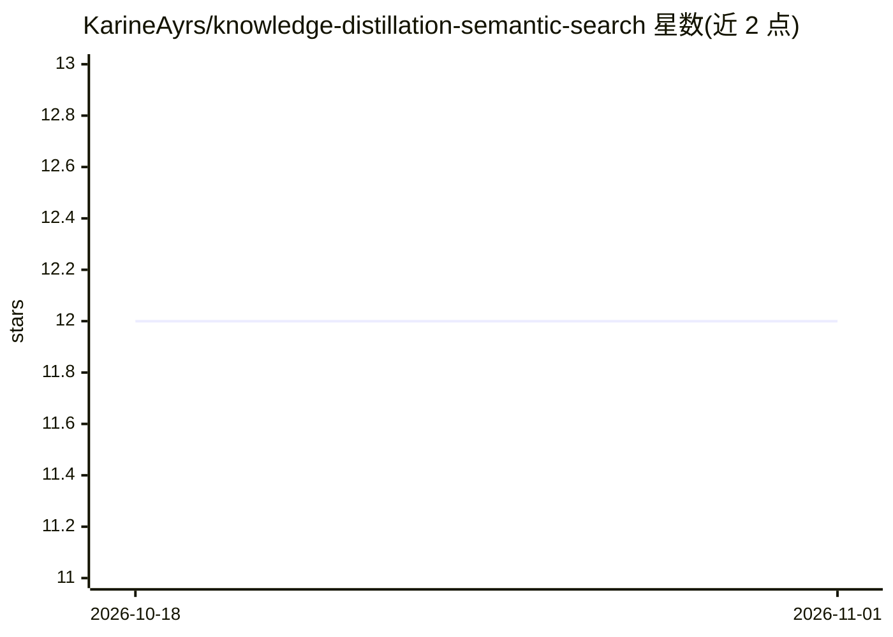

# KarineAyrs/knowledge-distillation-semantic-search

⭐ — · [GitHub]() · 个人维护

**用 LLM 知识蒸馏训练小模型做语义搜索的框架**

KDSS 是知识蒸馏框架：用大型语言模型（OpenAI API 或本地 Alpaca/gpt4all-lora 量化模型）为每篇文档生成 5 组语义相似样本，清洗后用于微调小模型（BERT/XLM-RoBERTa/DeBERTa-v3），产出保存于 checkpoints 目录的模型用于构建语义搜索嵌入。输入为 docs.csv 文档集，通过命令行参数选择教师模型与学生模型。使用 Alpaca 需自行下载量化模型文件并用脚本迁移格式。该仓库无明确安装命令与依赖清单，属于 2023 年早期实验性代码，需从源码运行。

## 筛选速览

| 维度 | 判定 | 备注 |
|---|---|---|
| AI 角色 | `ai-ecosystem` | LLM/agent 周边工具 |
| 许可风险 | `permissive` | — |
| 部署形态 | `library` | 以包/库形式分发 |
| 模型依赖 | — | README 未给出锁定关系 |
| 硬件要求 | — | 无带数字的原话,不猜 |
| 安装摩擦 | `low` | 无编译、无系统依赖或容器化 |
| 成熟度 | — | 结构信号不足 |

## 能力要点

- 支持 OpenAI 与本地 Alpaca（gpt4all-lora 量化）两种教师模型
- 每篇文档生成 5 组语义相似对作为合成训练数据
- 支持 BERT/XLM-RoBERTa/DeBERTa-v3 三种学生模型微调
- 微调后模型保存于 checkpoints 用于构建嵌入

## 适用场景

- 用 LLM 合成数据训练小模型以降低语义搜索成本
- 基于自有文档集构建领域语义检索嵌入
- 实验知识蒸馏方法生成训练数据

## 场景标签

`语义搜索` `微调` · 领域:知识与检索

## 证据(README 行号)

> L2: KDSS is the framework that allows to use knowledge of large language models to train smaller models.
> L8: - `main.py [-h] --large_model {openai,alpaca} [--alpaca_path [ALPACA_PATH]] --model {bert,xlmroberta,debertav3} [--p

## 星数曲线

2026-10-18 12 → 2026-11-01 12（+0）

---
*卡片 v1 · prompt 1.4 · 生成 2026-11-01 · 置信度 low · 依据 README sha `3f44156cdde5` · [字段定义](../../DATASET.md)*
