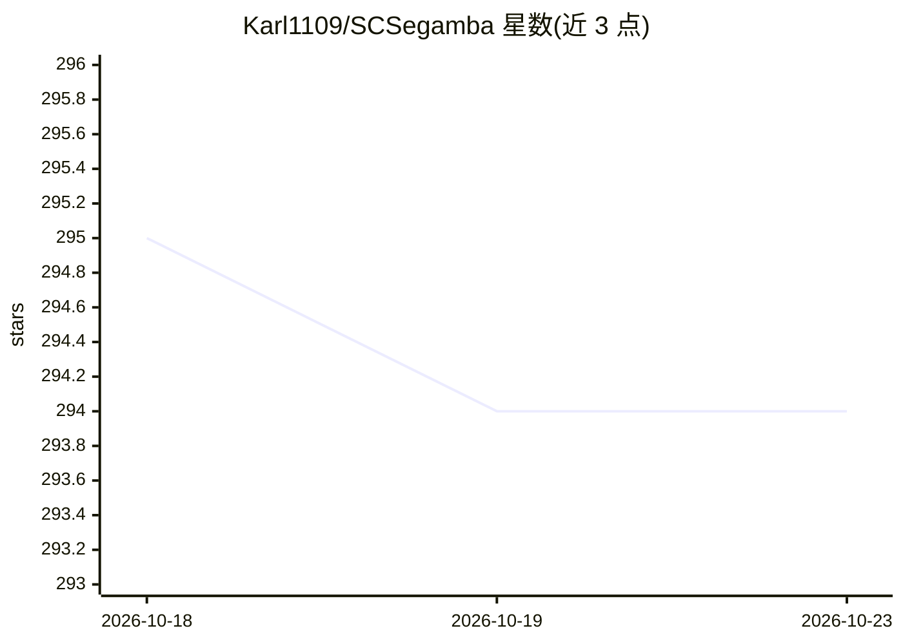

# Karl1109/SCSegamba

⭐ 294 · Python · Apache-2.0 · 推送 2025-11-27 · [GitHub](https://github.com/Karl1109/SCSegamba) · 组织维护

**轻量级 Mamba 结构裂缝分割网络（CVPR 2025，2.8M 参数）**

CVPR 2025 论文 SCSegamba 的官方开源实现：基于 Vision Mamba 的轻量级结构裂缝像素级分割网络，核心为 SAVSS 模块（含 GBC 门控瓶颈卷积与 SASS 结构感知扫描策略），利用裂缝形态与纹理信息生成分割图，参数量 2.8M，在多场景数据集上 F1 0.8390、mIoU 0.8479。提供 conda/pip 环境搭建步骤、训练（main.py）、推理（test.py）与指标计算脚本，并公开 Crack500/DeepCrack/CrackMap/TUT 四个数据集的划分、预训练 checkpoint 与真实视频推理可视化。Apache 2.0 许可，面向裂缝分割研究者。

## 筛选速览

| 维度 | 判定 | 备注 |
|---|---|---|
| AI 角色 | `ai-native` | 本体是模型或模型工具 |
| 许可风险 | `permissive` | Apache-2.0 |
| 部署形态 | `library` | 以包/库形式分发 |
| 模型依赖 | — | README 未给出锁定关系 |
| 硬件要求 | — | 无带数字的原话,不猜 |
| 安装摩擦 | `medium` | 含编译或系统依赖之一 |
| 成熟度 | — | 结构信号不足 |

## 能力要点

- SAVSS 模块：GBC 门控瓶颈卷积 + SASS 结构感知扫描策略
- 2.8M 参数量，多场景数据集 F1 0.8390 / mIoU 0.8479
- 公开四数据集划分、预训练 checkpoint 与真实视频推理结果
- 提供训练、推理、指标计算完整脚本

## 适用场景

- 结构裂缝的像素级分割研究与复现
- 在 Crack500/DeepCrack 等公开数据集上对比实验
- 用预训练 checkpoint 做裂缝检测推理或视频可视化

## 场景标签

`目标检测` · 领域:感知与多模态

## 证据(README 行号)

> L5:  [CVPR2025] SCSegamba: Lightweight Structure-Aware Vision Mamba for Crack Segmentation in Structures
> L25: Pixel-level segmentation of structural cracks across various scenarios remains a considerable challenge. Current me

## 星数曲线

2026-10-18 295 → 2026-10-23 294（-1）

---
*卡片 v1 · prompt 1.4 · 生成 2026-10-21 · 置信度 mid · 依据 README sha `722c67d141fe` · [字段定义](../../DATASET.md)*
