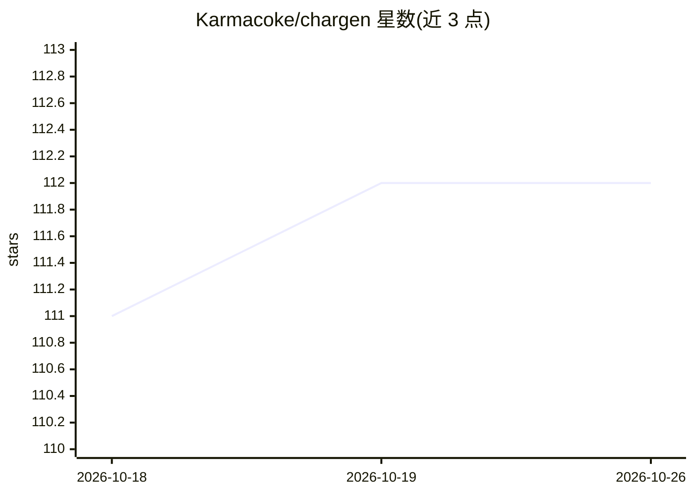

# Karmacoke/chargen

⭐ 112 · JavaScript · 推送 2026-02-13 · [GitHub](https://github.com/Karmacoke/chargen) · [官网](https://karmacoke.github.io/chargen/) · 个人维护 · 中文 README

**面向写作者与TRPG玩家的AI角色生成器**

基于 React 的网页工具，调用 Gemini、OpenAI、Claude、国产大模型或本地 Ollama 生成完整角色设定：基础档案、MBTI 心理画像、外貌、背景故事，并提供自定义/随机双模式、7 种世界观模板、5 级反俗套风格。可导出 NPC System Prompt 供 AI 对话使用、兼容 Stable Diffusion/Midjourney 的英文图像提示词及 JSON 数据。提供 GitHub Pages 在线版，本地运行需 Node.js，通过 git clone + npm install 启动。

## 筛选速览

| 维度 | 判定 | 备注 |
|---|---|---|
| AI 角色 | `ai-native` | 本体是模型或模型工具 |
| 许可风险 | `none` | — |
| 部署形态 | `library` | 以包/库形式分发 |
| 模型依赖 | local-ok | 支持本地模型 |
| 硬件要求 | — | 无带数字的原话,不猜 |
| 安装摩擦 | `low` | 无编译、无系统依赖或容器化 |
| 成熟度 | — | 结构信号不足 |

## 能力要点

- 生成完整角色档案（基础/心理/外貌/背景）
- 自动生成可复用的 NPC System Prompt
- 6 种视觉类型的英文图像提示词导出
- 支持 Gemini/OpenAI/Claude/国产模型/本地 Ollama 多模型接入

## 适用场景

- 小说、漫画创作时快速生成角色设定
- TRPG 跑团前生成玩家角色或 NPC
- 将角色转为 System Prompt 让 AI 扮演对话
- 为 Stable Diffusion/Midjourney 生成角色绘画提示词

## 场景标签

`AI 写作` · 领域:内容生成

## 证据(README 行号)

> L5: CharGen is an intelligent character generation tool based on React and AI Large Language Models (LLMs). It's designe
> L33: Automatically generates a System Prompt that can be directly copied into AI conversations (like ChatGPT), allowing 
> L37: Automatically generates English image prompts compatible with Stable Diffusion or Midjourney, supporting 6 professi

## 星数曲线

2026-10-18 111 → 2026-10-26 112（+1）

---
*卡片 v1 · prompt 1.4 · 生成 2026-10-23 · 置信度 high · 依据 README sha `709d8ae5c8db` · [字段定义](../../DATASET.md)*
