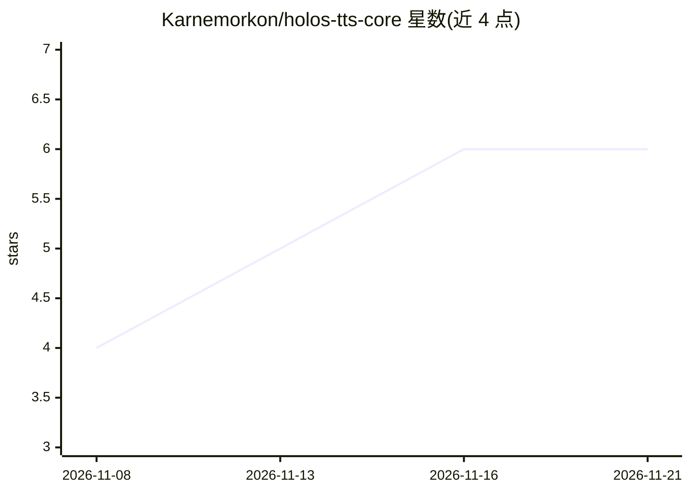

# Karnemorkon/holos-tts-core

⭐ 6 · C++ · MIT · 推送 2026-11-16 · [GitHub](https://github.com/Karnemorkon/holos-tts-core) · 个人维护

**乌克兰语 TTS 服务：C++20+ONNX 本地语音合成**

基于 ONNX Runtime 的原生 C++20 乌克兰语文本转语音服务器，运行时无需 Python。提供 REST、OpenAI 兼容接口、WebSocket 流式合成与内置 Web UI（端口 8004），支持 17 个 CC0 预设语音与从 WAV 克隆语音。自动言语化提供 neural（Gemma-3-270M int8）与 rule（正则）两种模式，重音通过 290 万词形词典加 accentor ONNX 模型处理。以 Docker 多架构镜像（amd64/arm64）与免 Docker 便携构建（AppImage/tar.gz/Windows 安装包）分发，首次启动下载约 0.8 GB 模型。

## 筛选速览

| 维度 | 判定 | 备注 |
|---|---|---|
| AI 角色 | `ai-native` | 本体是模型或模型工具 |
| 许可风险 | `permissive` | MIT |
| 部署形态 | `desktop` | 安装包/桌面程序 |
| 模型依赖 | — | README 未给出锁定关系 |
| 硬件要求 | — | 无带数字的原话,不猜 |
| 安装摩擦 | `low` | 无编译、无系统依赖或容器化 |
| 成熟度 | — | 结构信号不足 |

## 能力要点

- OpenAI 兼容 /v1/audio/speech 与 WebSocket 流式合成，含 Web UI 与多说话人对话合成
- 从 WAV 克隆语音，克隆后作为普通 voice 用于 REST/OpenAI API
- neural/rule 双模式自动言语化，重音词典 290 万词形，支持手动 + 号标注与用户自定义词典
- 多架构 Docker 镜像与 Linux/Windows 便携构建，81 个 unit/golden 测试

## 适用场景

- 为乌克兰语应用提供本地 TTS 语音合成服务
- 通过 OpenAI 兼容接口把语音能力接入现有工具链
- 克隆自定义音色并用于多说话人对话音频生成
- 在无 Python 的环境部署原生 C++ 语音服务

## 场景标签

`语音合成` · 领域:内容生成

## 证据(README 行号)

> L11: > **English summary:** production-ready Dockerized **Ukrainian text-to-speech** service
> L37: - **Потоковий синтез**: REST-стрім (`/v1/audio/speech`), WebSocket `/api/ws/synthesize`
> L143: `GET /healthz`, OpenAI-сумісний `POST /v1/audio/speech` і WebSocket `/api/ws/synthesize`.

## 星数曲线

2026-11-08 4 → 2026-11-21 6（+2）

---
*卡片 v1 · prompt 1.4 · 生成 2026-11-20 · 置信度 mid · 依据 README sha `13c9eb0bba20` · [字段定义](../../DATASET.md)*
