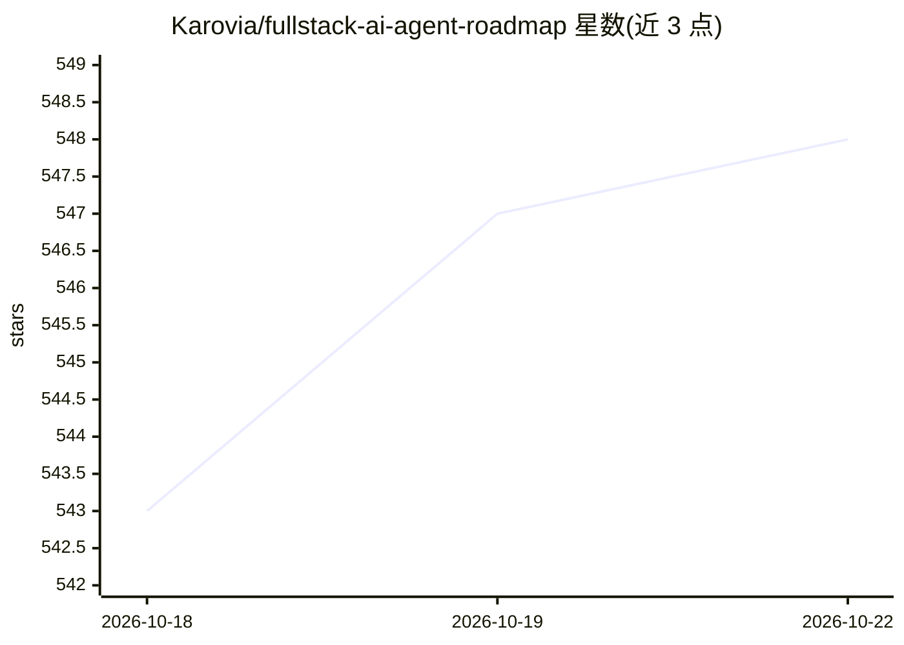

# Karovia/fullstack-ai-agent-roadmap

⭐ 553 · 推送 2026-09-07 · [GitHub](https://github.com/Karovia/fullstack-ai-agent-roadmap) · 个人维护 · 中文 README

**零基础到 AI Agent 全栈工程师的中文系统化教程路线**

用 Obsidian 组织的中文学习路线仓库：110 个 Markdown 教程 / 58 万字，覆盖 Python、JavaScript、React、FastAPI、数据库、LLM 与 AI Agent，每章配类比解释、完整可运行代码、练习题与验收项目，并精选 400+ 个标注学习用法的 GitHub 项目。学习机制为项目驱动 + 费曼学习法 + 造轮子（mini-react/mini-langchain/mini-agent），提供 Obsidian Canvas 思维导图与学习契约/周报模板，推荐学习周期 8-24 个月。内容按 CC BY-SA 4.0 发布。

## 筛选速览

| 维度 | 判定 | 备注 |
|---|---|---|
| AI 角色 | `ai-knowledge` | 知识聚合/清单类 |
| 许可风险 | `none` | — |
| 部署形态 | `library` | 以包/库形式分发 |
| 模型依赖 | — | README 未给出锁定关系 |
| 硬件要求 | — | 无带数字的原话,不猜 |
| 安装摩擦 | `low` | 无编译、无系统依赖或容器化 |
| 成熟度 | — | 结构信号不足 |

## 能力要点

- 110 个教程 / 58 万字，30+ 章节验收项目
- 400+ GitHub 项目精选，标注入门/进阶/源码级用法
- Obsidian Canvas 思维导图与学习契约/周报/里程碑模板
- 涵盖从零实现 GPT、mini-agent-sdk 与自建 MCP Server 的项目

## 适用场景

- 零基础系统学习全栈开发与 AI Agent 工程
- 按章节项目验收的方式自学并获得作品集
- 查找各阶段配套的开源项目进行源码学习

## 场景标签

`教程课程` `精选清单` · 领域:学习与行业

## 证据(README 行号)

> L5: > **从零基础到 AI 时代全栈工程师** —— 一份用 Obsidian 组织的、超过 **58 万字 / 110 个详细教程**的系统化学习路线。
> L15: 不是一份链接清单。这是一套 **"零基础 → 能独立交付 AI Agent 产品"** 的完整教程包：
> L20: - ⭐ **400+ 精选 GitHub 项目** —— 每个都标注"该怎么用它学"

## 星数曲线

2026-10-18 543 → 2026-10-22 548（+5）

---
*卡片 v1 · prompt 1.4 · 生成 2026-10-21 · 置信度 mid · 依据 README sha `f678d3c2fb92` · [字段定义](../../DATASET.md)*
