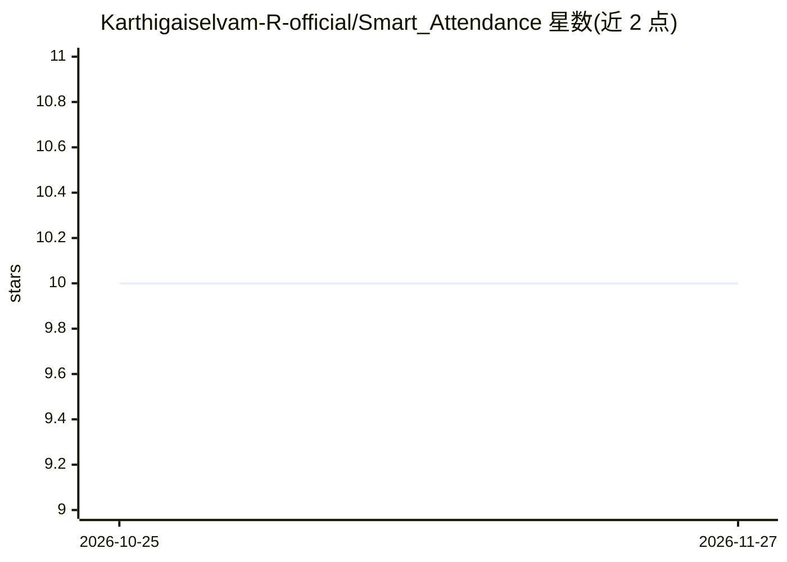

# Karthigaiselvam-R-official/Smart_Attendance

⭐ 10 · Python · MIT · 推送 2026-01-04 · [GitHub](https://github.com/Karthigaiselvam-R-official/Smart_Attendance) · [官网](https://smartattendancev2.vercel.app/) · 个人维护

**人脸识别考勤桌面应用：多脸识别并导出考勤记录**

基于 OpenCV 的桌面考勤系统，通过摄像头实时检测并识别画面中的多个人脸，以 LBPH 算法匹配已注册学生并显示姓名与置信度。工作流为采集注册照片、训练模型、开启识别三个步骤；考勤记录含日期与时间，可导出带图表的 Excel/CSV。带 CustomTkinter 界面、暗色主题切换，管理面板以 SHA-256 哈希校验密码，数据存于本地。安装需 Python 3.8+ 与摄像头。

## 筛选速览

| 维度 | 判定 | 备注 |
|---|---|---|
| AI 角色 | `ai-native` | 本体是模型或模型工具 |
| 许可风险 | `permissive` | MIT |
| 部署形态 | `library` | 以包/库形式分发 |
| 模型依赖 | — | README 未给出锁定关系 |
| 硬件要求 | — | 无带数字的原话,不猜 |
| 安装摩擦 | `low` | 无编译、无系统依赖或容器化 |
| 成熟度 | — | 结构信号不足 |

## 能力要点

- LBPH 算法实时识别多人脸并显示置信度
- 考勤记录导出为带图表的 Excel/CSV
- SHA-256 哈希保护的管理面板与本地数据存储
- 内置 Vercel API 配置文件供扩展云后端

## 适用场景

- 课堂上用摄像头自动记录学生出勤
- 注册学生人脸后按科目生成分次考勤表
- 在管理面板查看并导出考勤统计

## 场景标签

`人脸识别` · 领域:感知与多模态

## 证据(README 行号)

> L20: - **Multi-Face Detection**: Recognize multiple students simultaneously in a single frame.
> L55: - **Computer Vision**: OpenCV (Face Detection & Recognition)
> L10:  A robust, secure, and modern desktop application that automates attendance management using advanced computer visi

## 星数曲线

2026-10-25 10 → 2026-11-27 10（+0）

---
*卡片 v1 · prompt 1.4 · 生成 2026-11-20 · 置信度 high · 依据 README sha `b9a5442efc19` · [字段定义](../../DATASET.md)*
