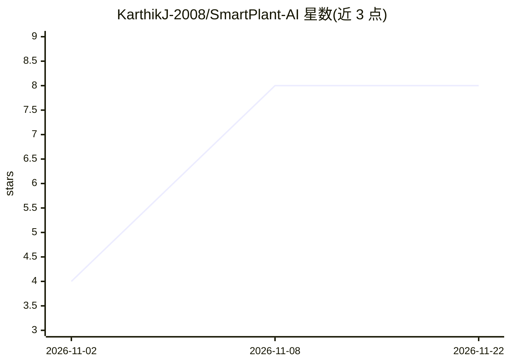

# KarthikJ-2008/SmartPlant-AI

⭐ 8 · Jupyter Notebook · 推送 2026-10-30 · [GitHub](https://github.com/KarthikJ-2008/SmartPlant-AI) · 个人维护

**Web 应用：从叶片图像识别 20 类作物病害，供农民与农艺师使用**

基于 Flask 的深度学习 Web 应用，上传叶片图像后用量化 TensorFlow Lite（LiteRT）模型实时分类病害，覆盖苹果、玉米、马铃薯、番茄 4 种作物的 20 个类别。内置 65% 置信度阈值过滤非叶片输入并输出安全回退提示；用户注册登录采用 pbkdf2:sha256 会话哈希；诊断历史同步至 MongoDB Atlas，按时间戳记录预测与置信度。提供 Render 免费层的在线演示，本地运行需 Python 3.10 与 MongoDB。

## 筛选速览

| 维度 | 判定 | 备注 |
|---|---|---|
| AI 角色 | `ai-native` | 本体是模型或模型工具 |
| 许可风险 | `none` | — |
| 部署形态 | `library` | 以包/库形式分发 |
| 模型依赖 | — | README 未给出锁定关系 |
| 硬件要求 | — | 无带数字的原话,不猜 |
| 安装摩擦 | `low` | 无编译、无系统依赖或容器化 |
| 成熟度 | — | 结构信号不足 |

## 能力要点

- 量化 TFLite 模型（约 1.6MB，<60MB RAM）推理，覆盖 4 种作物 20 类病害
- 65% 置信度阈值区分分布外输入并回退提示，避免误报化学处理建议
- MongoDB Atlas 同步多用户时间戳诊断历史
- 提供 Render 在线演示与移动端自适应界面

## 适用场景

- 田间拍照快速判断作物叶片病害类型
- 农艺教学中演示深度学习分类部署流程
- 园艺爱好者识别番茄/马铃薯常见病害

## 场景标签

`目标检测` `模型量化` · 领域:感知与多模态

## 证据(README 行号)

> L9: **SmartPlant-AI** is an end-to-end, deep learning-powered agronomy web application engineered to diagnose foliar pla
> L25: - **⚡ Ultra-Fast Edge Inference**: Utilizes a highly quantized **TensorFlow Lite (LiteRT)** model operating at unde
> L56: The model is trained on tens of thousands of curated crop leaf images, accurately categorizing **20 distinct classe

## 星数曲线

2026-11-02 4 → 2026-11-22 8（+4）

---
*卡片 v1 · prompt 1.4 · 生成 2026-11-20 · 置信度 high · 依据 README sha `23a6def45b48` · [字段定义](../../DATASET.md)*
