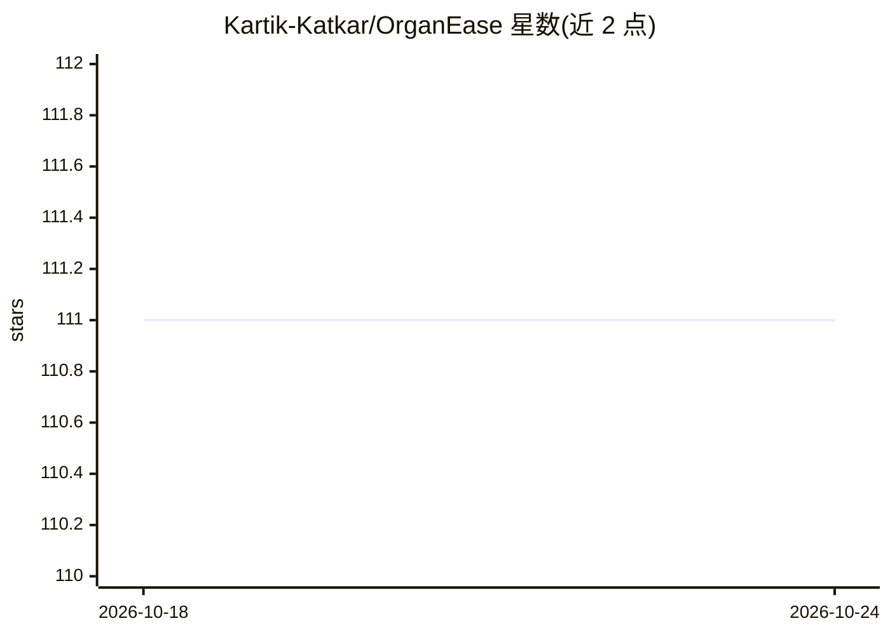

# Kartik-Katkar/OrganEase

⭐ 111 · CSS · MIT · 推送 2026-10-01 · [GitHub](https://github.com/Kartik-Katkar/OrganEase) · [官网](https://organ-ease.vercel.app) · 个人维护

**器官捐赠管理平台：连接捐献中心与移植医院**

基于 MERN 栈（MongoDB/Express/React/Node.js）的器官捐赠管理网站，面向器官采购中心、移植中心与医院。功能包括：各中心将低温储存的器官及其详情集中展示于平台，医院按血型等兼容性条件通过门户发起器官请求并支付作为确认凭证，采购中心再在平台侧确认请求，替代原先依赖传真、邮件和电话的人工流程。安装方式为在 client 与 server 目录分别执行 npm install 后运行。README 未描述具体的 AI 模型或算法实现，仅仓库主题标签含 ai/algorithms。

## 筛选速览

| 维度 | 判定 | 备注 |
|---|---|---|
| AI 角色 | `ai-enhanced` | 去掉 AI 部分产品仍成立 |
| 许可风险 | `permissive` | MIT |
| 部署形态 | `library` | 以包/库形式分发 |
| 模型依赖 | — | README 未给出锁定关系 |
| 硬件要求 | — | 无带数字的原话,不猜 |
| 安装摩擦 | `low` | 无编译、无系统依赖或容器化 |
| 成熟度 | — | 结构信号不足 |

## 能力要点

- 多采购/移植中心集中展示库存器官及详情
- 医院按血型等兼容性条件在线发起请求并支付确认
- 采购中心门户侧确认请求的流转机制

## 适用场景

- 医院按兼容性条件查找并请求可用器官
- 采购中心集中展示储存器官信息
- 替代传真/邮件/电话的人工器官协调流程

## 场景标签

 · 领域:医疗/器官捐赠管理

## 证据(README 行号)

> L53: As organs are needed x for operations, time is the most crucial aspect. However, the existing method to request org
> L55: The website makes the tedious manual task of categorizing different organs and making entries for each, mere clicks
> L57: Hospitals can request organs of suitable compatibility (Blood Group, etc) via the portal itself and make a payment 

## 星数曲线

2026-10-18 111 → 2026-10-24 111（+0）

---
*卡片 v1 · prompt 1.4 · 生成 2026-10-23 · 置信度 low · 依据 README sha `785ed86ce7cb` · [字段定义](../../DATASET.md)*
