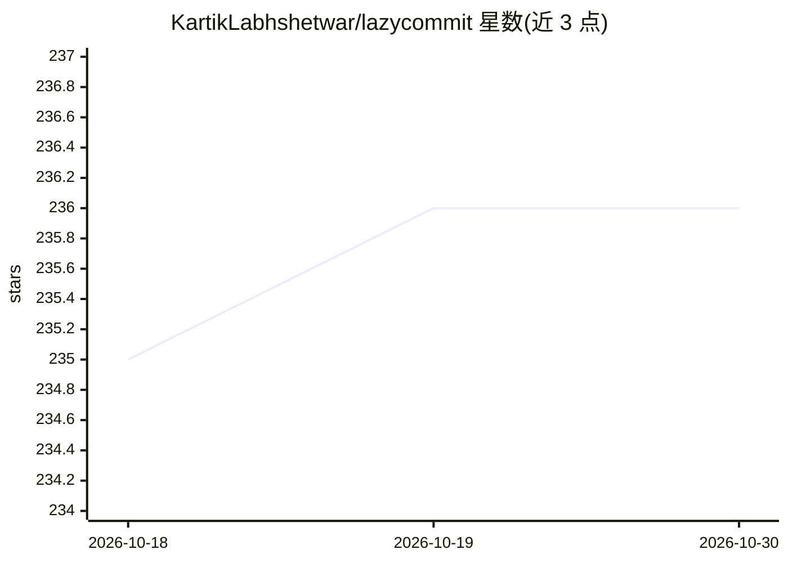

# KartikLabhshetwar/lazycommit

⭐ 236 · TypeScript · Apache-2.0 · 推送 2026-09-30 · [GitHub](https://github.com/KartikLabhshetwar/lazycommit) · [官网](https://www.npmjs.com/package/lazycommitt) · 个人维护

**用 AI 从暂存改动生成 git 提交信息的命令行工具**

TypeScript 编写的 CLI（命令 lazycommit / lzc）：读取 Git 暂存区的 diff 上下文，发送给用户选择的 AI 提供商（OpenAI、Gemini、Anthropic、Kimi、DeepSeek、GLM、MiniMax、Groq），生成供审查、编辑或重新生成的提交主题；确认前不会提交。支持 Conventional Commits 格式、非交互模式、Git hook、大改动的分批摘要（--thorough），以及提交后一键 push。模型经 Mastra 路由，需 Node.js 22.13+ 与提供商 API key。

## 筛选速览

| 维度 | 判定 | 备注 |
|---|---|---|
| AI 角色 | `ai-native` | 本体是模型或模型工具 |
| 许可风险 | `permissive` | Apache-2.0 |
| 部署形态 | `library` | 以包/库形式分发 |
| 模型依赖 | locked-api |  |
| 硬件要求 | — | 无带数字的原话,不猜 |
| 安装摩擦 | `low` | 无编译、无系统依赖或容器化 |
| 成熟度 | — | 结构信号不足 |

## 能力要点

- 8 家 AI 提供商可选，lzc model 从列表挑模型
- 大改动支持 diff 采样与 --thorough 分批摘要（上限 160 万字符）
- 支持 Conventional Commits、多建议生成、dry-run 预览与 Git hook
- 提交前校验暂存树未变，只提交暂存内容

## 适用场景

- 替我根据 staged 改动写提交信息再确认提交
- 大范围代码变更时分批摘要后生成规范化提交主题
- 通过 Git hook 在原生 git commit 中生成建议信息

## 场景标签

`AI 写作` · 领域:内容生成

## 证据(README 行号)

> L12: Lazycommit is a TypeScript CLI that uses Git and an AI provider of your choice to generate commit subjects from you
> L15: - **Choose your provider:** OpenAI, Gemini, Anthropic, Kimi, DeepSeek, GLM, MiniMax, or Groq, then pick a model fro

## 星数曲线

2026-10-18 235 → 2026-10-30 236（+1）

---
*卡片 v1 · prompt 1.4 · 生成 2026-10-22 · 置信度 high · 依据 README sha `a14c3c747677` · [字段定义](../../DATASET.md)*
